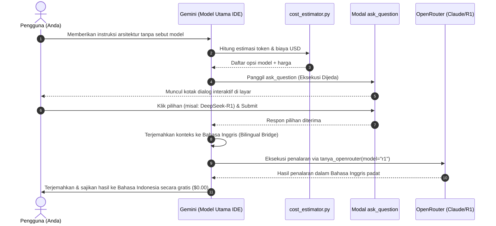

# 📚 Panduan Lengkap Ekosistem Vibe Tools

Dokumentasi komprehensif yang mengkonsolidasikan seluruh tutorial, panduan, dan best practice ekosistem vibe_tools dalam satu sumber terpadu.

---

## 📑 Daftar Isi

1. [Docstring Translator Bilingual](#1-docstring-translator-bilingual)
2. [Testing Modal ask_question](#2-testing-modal-ask_question)
3. [Sinkronisasi Git Submodule vibe_tools](#3-sinkronisasi-git-submodule-vibe_tools)
4. [REA MCP: Reverse Engineer Anything](#4-rea-mcp-reverse-engineer-anything)
5. [Hermes Agent x Antigravity IDE](#5-hermes-agent-x-antigravity-ide)
6. [OpenRouter MCP & Katalog Model](#6-openrouter-mcp--katalog-model)
7. [FAQ & Troubleshooting](#7-faq--troubleshooting)

---


## 1. Docstring Translator Bilingual

Dokumen ini menjelaskan cara penggunaan, konfigurasi API Key, penanganan limit kuota (rate limiting), serta arsitektur auto-fallback pada modul `docstring_translator.py`.

---

## 🎯 1. Latar Belakang & Tujuan

Saat mengembangkan proyek open-source atau berkolaborasi secara tim:
* **Pengembang Lokal (Indonesia)**: Lebih nyaman menulis penjelasan alur fungsi dan logika menggunakan Bahasa Indonesia (`[ID]`).
* **Kontributor Internasional & AI Coding**: Memerlukan padanan Bahasa Inggris (`[EN]`) agar model reasoning (seperti Claude, GPT-4, DeepSeek) atau kontributor luar negeri dapat memahami basis kode dengan akurat.

Modul `docstring_translator.py` membaca berkas Python secara otomatis menggunakan **Python AST (Abstract Syntax Tree)**. Script ini:
1. Mendeteksi docstring modul, kelas, fungsi, dan async function.
2. Memeriksa apakah docstring sudah memiliki format dwibahasa `[EN]`.
3. Menerjemahkan deskripsi Bahasa Indonesia ke Bahasa Inggris teknis yang ringkas dan profesional.
4. Memperbarui docstring menjadi dwibahasa tanpa mengubah satu barispun logika, indentasi, atau format kode asli.

---

## 📦 2. Prasyarat & Instalasi

Script ini hanya memerlukan pustaka HTTP bawaan `requests`:

```powershell
pip install requests
```

---

## 🔑 3. Konfigurasi API Key

Script mendukung dua engine AI sekaligus dan membaca kunci secara otomatis tanpa perlu konfigurasi manual setiap kali dijalankan:

| Engine | Sumber Kunci Lokal | Variabel Lingkungan (Env) | Kelebihan |
| :--- | :--- | :--- | :--- |
| **Google Gemini** | `~/.gemini/gemini_key.txt` | `GEMINI_API_KEY` / `GOOGLE_API_KEY` | **100% Gratis** via Google AI Studio. |
| **OpenRouter** | `~/.gemini/openrouter_key.txt` | `OPENROUTER_API_KEY` | **Sangat Cepat**, tidak ada limit 15 RPM, biaya ultra-hemat (~Rp 0.3 per docstring via DeepSeek Chat). |

> [!TIP]
> Anda dapat menyimpan kedua kunci tersebut sekaligus di folder pengguna `~/.gemini/`. Script akan otomatis mendeteksi ketersediaan keduanya.

---

## 🚀 4. Cara Penggunaan & Perintah CLI

### A. Mode Auto-Fallback (Direkomendasikan)
Menjalankan sinkronisasi dengan mencoba **Gemini gratis terlebih dahulu**. Jika kuota Gemini habis (HTTP 429) atau server Google sibuk (HTTP 503), script **otomatis beralih ke OpenRouter di tengah jalan**:

```powershell
# Memproses seluruh folder vibe_tools
python vibe_tools/docstring_translator.py vibe_tools/

# Memproses seluruh proyek saat ini
python vibe_tools/docstring_translator.py .

# Memproses satu berkas spesifik
python vibe_tools/docstring_translator.py vibe_tools/push_to_github.py
```

---

### B. Mode Paksa OpenRouter (Bebas Hambatan Kuota)
Jika Anda memiliki banyak berkas atau docstring panjang dan ingin proses selesai super cepat tanpa terkena jeda kuota:

```powershell
python vibe_tools/docstring_translator.py --engine openrouter vibe_tools/
```

---

### C. Mode Paksa Gemini (100% Gratis)
Jika Anda hanya ingin memanfaatkan kuota gratis Google AI Studio:

```powershell
python vibe_tools/docstring_translator.py --engine gemini vibe_tools/
```

---

### D. Mode Dry-Run (Pratinjau Tanpa Mengubah Berkas Fisik)
Gunakan flag `--dry-run` untuk melihat berapa banyak docstring yang perlu disinkronkan tanpa menyentuh isi file:

```powershell
python vibe_tools/docstring_translator.py --dry-run vibe_tools/
```

---

### E. Mengatur Jeda Panggilan (Throttling Delay)
Secara default, saat menggunakan Gemini, script memberi jeda `2.0` detik antar docstring agar tidak melampaui batas 15 RPM. Anda dapat menyesuaikannya:

```powershell
python vibe_tools/docstring_translator.py --delay 3.0 vibe_tools/
```

---

## 🛡️ 5. Penanganan Error & Mekanisme Pengamanan

### 1. Error HTTP 503 (High Demand / Overload)
* **Penyebab**: Server Google AI Studio sedang mengalami lonjakan beban pengguna.
* **Solusi Otomatis**: Script akan mendeteksi status 503 dan langsung mengalihkan terjemahan ke OpenRouter secara instan.

### 2. Error HTTP 429 (Quota Exceeded / Rate Limit 15 RPM)
* **Penyebab**: Kuota gratis Gemini membatasi maksimal 15 panggilan per menit (Requests Per Minute). Menerjemahkan berkas dengan banyak fungsi berturut-turut tanpa jeda akan memicu limit ini.
* **Solusi Otomatis**: 
  - Script menyisipkan jeda aman (`--delay 2.0`).
  - Jika 429 tetap muncul, fitur auto-fallback langsung memindahkan sisa antrean ke OpenRouter sehingga eksekusi tidak macet.

### 3. Apa yang Terjadi Jika Dibatalkan (`Ctrl + C`)?
* **Mekanisme Auto-Save Parsial**:
  Jika Anda membatalkan eksekusi di tengah-tengah proses menggunakan `Ctrl + C`, script memiliki penangkap sinyal `KeyboardInterrupt`.
  Docstring yang **sudah sempat berhasil diterjemahkan akan langsung disimpan secara aman ke berkas fisik** sebelum program benar-benar berhenti. Anda tidak perlu khawatir kehilangan progres yang sudah dicapai!

---

## 🤖 6. Otomasi Otomatis via GitHub Actions

Untuk menjaga agar repositori publik Anda selalu memiliki docstring bilingual setiap kali ada commit/push baru, alur kerja GitHub Actions telah disediakan di:
`.github/workflows/bilingual_sync.yml`

### Langkah Aktivasi di GitHub:
1. Buka Repositori GitHub Anda.
2. Buka menu **Settings** > **Secrets and variables** > **Actions**.
3. Buat New repository secret:
   * **Name**: `GEMINI_API_KEY`
   * **Secret**: Kunci API dari Google AI Studio Anda.
4. Selesai! Setiap kali Anda melakukan `git push` berkas `.py`, GitHub Actions akan otomatis menerjemahkan docstring baru dan melakukan commit balik ke branch Anda dengan pesan `[skip ci]`.


---

## 2. Testing Modal ask_question

Dokumen ini berisi panduan praktis dan contoh prompt siap pakai untuk menguji fitur **Interactive Model Selector & Modal Dialog (`ask_question`)** di Antigravity IDE.

---

## 🧭 Apa Itu Tool `ask_question` di Antigravity IDE?

`ask_question` adalah tool antarmuka visual bawaan Antigravity IDE yang berfungsi memunculkan **jendela modal interaktif (radio button/pilihan klik)** di layar pengguna. 

Ketika tool ini dipanggil oleh AI:
1. **Eksekusi Dijeda (Blocked Execution)**: AI berhenti sejenak dan menunggu respon klik dari Anda.
2. **Pilihan Ditampilkan di Layar**: Menampilkan daftar opsi model AI beserta estimasi biaya USD dan token in/out (`cost_estimator.py`).
3. **Respon Diteruskan**: Setelah Anda memilih dan menekan tombol **Submit**, AI akan langsung mengeksekusi tugas sesuai model pilihan Anda.

---

## 🧪 3 Skenario Pengujian Praktis (Siap Copy-Paste)

Anda dapat menguji fitur ini kapan saja di chat Antigravity IDE menggunakan salah satu skenario di bawah ini:

### Skenario 1: Pengujian Simulasi Langsung (Paling Cepat)
Gunakan prompt ini jika Anda hanya ingin melihat dan mencoba mengeklik modal dialog di layar:

```text
Tolong panggil tool ask_question untuk menampilkan pilihan model AI beserta estimasi biayanya untuk pengujian.
```

* **Hasil yang Diharapkan**: Modal dialog pilihan model (DeepSeek-R1, Claude Sonnet 4.5, DeepSeek-V3, Gemini Flash IDE Gratis, Hermes Agent) langsung muncul di tengah layar IDE Anda.

---

### Skenario 2: Pengujian Otomatis Alami (Natural Trigger)
Sesuai aturan di [.agents/AGENTS.md](file:///d:/mobog/Videos/Youtube%20Download/.agents/AGENTS.md), jika Anda meminta tugas penalaran atau arsitektur rumit **tanpa menyebutkan nama model**, AI wajib memunculkan modal `ask_question` terlebih dahulu untuk mencegah pembengkakan saldo OpenRouter tanpa izin.

Contoh prompt:
```text
Tolong rancang arsitektur sinkronisasi multi-threading dan locking protocol untuk download queue agar terhindar dari race condition.
```

* **Hasil yang Diharapkan**:
  1. AI mendeteksi bahwa ini adalah tugas arsitektur kompleks.
  2. Karena Anda tidak menyebutkan model (seperti "pakai claude" atau "pakai r1"), AI menghitung estimasi token melalui `cost_estimator.py`.
  3. AI memunculkan modal dialog `ask_question` agar Anda yang menentukan apakah ingin menggunakan Claude Sonnet (~$0.024), DeepSeek-R1 (~$0.003), atau Gemini Flash Gratis ($0.00).

---

### Skenario 3: Memilih Opsi Kustom (Write-In Option)
Pada modal dialog `ask_question`, Antigravity IDE menyediakan kolom isian bebas (*Write-in text*) di bagian bawah secara default.

1. Jalankan prompt dari **Skenario 1**.
2. Alih-alih memilih tombol radio yang tersedia, ketik instruksi khusus pada kolom input (misal: *"Gunakan model Qwen Coder saja"*).
3. Klik **Submit**.
4. AI akan menerima pesan kustom Anda dan menjalankannya sesuai arahan tersebut.

---

## 🔄 Apa yang Terjadi di Balik Layar Setelah Anda Mengklik?



---

## 🛠️ Troubleshooting

1. **Mengapa modal tidak muncul dan AI langsung mengeksekusi?**
   - Periksa prompt Anda: jika Anda sudah menyebutkan model (misal: *"analisis pakai claude..."* atau *"gunakan r1..."*), AI akan langsung merouting ke model tersebut tanpa memunculkan pertanyaan karena preferensi Anda sudah jelas.
2. **Apakah modal bisa memunculkan checkbox (banyak pilihan)?**
   - Ya. Tool `ask_question` mendukung parameter `is_multi_select: true` jika Anda ingin mengizinkan pemilihan lebih dari satu opsi sekaligus.
3. **Bagaimana jika saya menekan tombol Skip?**
   - Jika Anda menekan tombol **Skip**, AI akan melanjutkan dengan opsi rekomendasi default (*fallback*) atau menggunakan Model Utama IDE Gemini Flash secara gratis.


---

## 3. Sinkronisasi Git Submodule vibe_tools

Dokumen ini menjelaskan alur lengkap untuk **mengambil pembaruan (Pull)** dari repositori induk [baliaga-repo/vibe-tools](https://github.com/baliaga-repo/vibe-tools.git) ke dalam proyek kerja Anda, serta **mengirimkan kontribusi lokal (Push)** kembali ke GitHub.

---

## 🧭 Gambaran Arsitektur

Direktori `vibe_tools/` di dalam proyek ini didaftarkan sebagai **Git Submodule** melalui file `.gitmodules`:

```ini
[submodule "vibe_tools"]
	path = vibe_tools
	url = https://github.com/baliaga-repo/vibe-tools.git
```

Artinya:
- Proyek utama (misal: `Scrapper_new_acmt`) menyimpan referensi **ID Commit** tertentu dari repositori `vibe-tools`.
- Repositori `vibe-tools` memiliki siklus *commit* dan riwayat Git independen.

---

## 📥 Skenario 1: Mengambil Pembaruan dari GitHub (Pull / Sync)

Gunakan alur ini saat repositori https://github.com/baliaga-repo/vibe-tools.git telah diperbarui (fitur baru, perbaikan bug, atau penambahan skrip) dan Anda ingin menyinkronkannya ke dalam proyek ini.

### Langkah 1: Bersihkan Gangguan `desktop.ini` (Khusus Windows / Google Drive)
Jika repositori berada di dalam folder yang disinkronkan Google Drive di Windows, berkas tersembunyi `desktop.ini` sering terbuat di dalam struktur folder internal Git (`.git/modules/vibe_tools/refs/`), memicu pesan error:
```text
fatal: bad object refs/desktop.ini
```

Jalankan perintah PowerShell ini untuk membersihkannya secara aman:
```powershell
Get-ChildItem -Path .git -Filter "desktop.ini" -Recurse -Force | Remove-Item -Force
```

### Langkah 2: Ambil Pembaruan Terbaru (Fetch & Pull)

**Opsi A: Langsung dari Root Proyek via Submodule CLI (Direkomendasikan)**
```powershell
git submodule update --remote --merge vibe_tools
```

**Opsi B: Menggunakan Perintah Git Terarah ke Subfolder**
```powershell
# Simpan perubahan lokal sementara jika ada file yang diedit
git -C vibe_tools stash

# Tarik commit terbaru dari branch main
git -C vibe_tools pull origin main

# Kembalikan perubahan lokal jika sebelumnya di-stash
git -C vibe_tools stash pop
```

### Langkah 3: Catat Referensi Commit Baru di Proyek Utama
Setelah isi `vibe_tools` terbarui, Git pada repositori utama akan mendeteksi perubahan pointer subproject:
```powershell
git status -s
# Hasil: M vibe_tools
```

Simpan perubahan pointer commit ini ke riwayat Git proyek utama Anda:
```powershell
git add vibe_tools
git commit -m "chore: perbarui submodule vibe_tools ke versi terbaru"
```

---

## 📤 Skenario 2: Mengirimkan Pembaruan Lokal ke GitHub (Push)

Gunakan alur ini jika Anda baru saja menambahkan atau memodifikasi berkas di dalam `vibe_tools/` (misalnya menambah skrip baru atau memperbarui panduan) dan ingin mempublikasikannya ke repositori GitHub `vibe-tools`.

### Langkah 1: Menggunakan Skrip Otomatis `push_to_github.py`
Di dalam `vibe_tools/` sudah tersedia skrip pembantu yang otomatis membersihkan `desktop.ini`, memvalidasi remote, dan meminta pesan commit:

```powershell
# Jalankan skrip pendorong
python vibe_tools/push_to_github.py
```

### Langkah 2: Alternatif Manual via Git CLI
Jika Anda ingin mengeksekusinya secara manual langkah-demi-langkah:
```powershell
# Bersihkan desktop.ini di dalam vibe_tools
Get-ChildItem -Path vibe_tools -Filter "desktop.ini" -Recurse -Force | Remove-Item -Force

# Lakukan commit di dalam folder submodule
git -C vibe_tools add .
git -C vibe_tools commit -m "feat/fix: deskripsi perubahan fitur"
git -C vibe_tools push origin main
```

### Langkah 3: Perbarui Pointer di Proyek Utama
Setelah berhasil di-push ke GitHub, perbarui juga pointer submodule di proyek utama:
```powershell
git add vibe_tools
git commit -m "chore: perbarui pointer commit vibe_tools setelah push"
```

---

## 🚀 Skenario 3: Clone Proyek Baru yang Memiliki `vibe_tools`

Jika Anda berpindah komputer atau melakukan clone proyek dari awal:

### Opsi 1: Clone Sekaligus Submodule (1 Langkah)
```bash
git clone --recurse-submodules https://github.com/baliaga-repo/Scrapper_new_acmt.git
```

### Opsi 2: Inisialisasi Submodule Setelah Clone Biasa
Jika proyek sudah terlanjur di-clone tanpa flag `--recurse-submodules`:
```bash
git submodule update --init --recursive
```

---

## 📋 Tabel Rangkuman Perintah Singkat

| Tindakan | Perintah PowerShell / Bash |
| :--- | :--- |
| **Bersihkan Cache GDrive** | `Get-ChildItem -Path .git -Filter "desktop.ini" -Recurse -Force \| Remove-Item -Force` |
| **Pull Update GitHub** | `git submodule update --remote --merge vibe_tools` |
| **Cek Perubahan Lokal** | `git -C vibe_tools status -s` |
| **Push via Skrip Helper** | `python vibe_tools/push_to_github.py` |
| **Push Manual** | `git -C vibe_tools add . && git -C vibe_tools commit -m "update" && git -C vibe_tools push origin main` |
| **Kunci Pointer di Induk** | `git add vibe_tools && git commit -m "chore: update submodule pointer"` |


---

## 4. REA MCP: Reverse Engineer Anything

REA (*Reverse Engineer Anything*) adalah MCP server berbasis Node.js yang memberikan kemampuan **reverse engineering mendalam** kepada AI Agent. Dibangun oleh [morluto/rea](https://github.com/morluto/rea) dan tersedia di npm sebagai `rea-agents`.

Dengan REA aktif di Antigravity IDE, Anda dapat meminta AI untuk:
- Membedah fitur aplikasi **tanpa source code** (hanya dari binary/ASAR/APK).
- Menganalisis bundle JavaScript/Electron yang dikompilasi (*minified*/*obfuscated*).
- Menginspeksi lalu lintas jaringan tersimpan (HAR, mitmproxy, Fiddler).
- Mendekompilasi file biner native (`.exe`, `.dll`, ELF, Mach-O) via Ghidra/Hopper/IDA.
- Membongkar APK Android, IPA iOS, atau paket HarmonyOS HAP.

---

## ⚡ Instalasi Cepat

```bash
python vibe_tools/install_rea_mcp.py
```

Setelah selesai, **restart Antigravity IDE sekali**. REA langsung aktif dengan 207 tools reverse engineering.

---

## 🧭 Kapan Menggunakan REA?

| Situasi | Gunakan REA? |
| :--- | :---: |
| Analisis **source code repository biasa** (ada `.py`, `.js`, `.ts`) | ❌ Tidak perlu |
| Membedah file **ASAR, APK, IPA, .exe, .dll** tanpa source code | ✅ Ya |
| Menganalisis **bundle JavaScript terkompilasi** (webpack, rollup, vite) | ✅ Ya |
| Menginspeksi **lalu lintas HTTP** yang direkam (HAR, mitmproxy) | ✅ Ya |
| Meniru fitur dari aplikasi lain ke proyek Anda | ✅ Ya |
| Mengaudit aplikasi untuk tracker/telemetri tersembunyi | ✅ Ya |
| Membandingkan dua versi aplikasi untuk melihat perubahan | ✅ Ya |

---

## 🚀 Panduan Penggunaan

### 1. Analisis Aplikasi Electron/ASAR (Paling Umum & Tanpa Decompiler)

**Via Terminal (tanpa konfigurasi MCP):**
```bash
npx -y rea-agents@latest analyze-javascript-application /path/absolut/ke/app
```

**Template Prompt di Antigravity IDE:**
```text
Gunakan REA untuk menganalisis aplikasi Electron di folder:
D:/apps/NamaAplikasi
Saya ingin memahami bagaimana fitur [nama fitur] bekerja secara internal.
Tampilkan temuan beserta buktinya dan pisahkan antara observasi vs inferensi.
```

---

### 2. Analisis Web Bundle / Webpack

**Template Prompt:**
```text
Gunakan REA untuk menganalisis bundle JavaScript dari halaman:
https://example.com
Target: halaman [nama halaman], endpoint: [URL endpoint jika diketahui]
Saya ingin mengetahui struktur modul, import, dan dependensinya.
```

---

### 3. Analisis APK Android

**Template Prompt:**
```text
Gunakan REA untuk menginspeksi APK Android:
/path/ke/aplikasi.apk
Cari class yang mengandung logika [autentikasi / enkripsi / tracking].
Tampilkan referensi masuk dan keluar untuk class yang relevan.
```

---

### 4. Membandingkan Dua Versi Aplikasi

**Template Prompt:**
```text
Gunakan REA untuk membandingkan dua versi bundle JavaScript:
- Versi lama: /path/ke/app_v1/
- Versi baru: /path/ke/app_v2/
Tunjukkan perubahan fitur, modul baru yang ditambahkan, dan modul yang dihapus.
```

---

### 5. Dekompilasi Binary Native (Perlu Ghidra/Hopper/IDA)

> ⚠️ **Prasyarat Tambahan:** Salah satu dari Ghidra, Hopper, atau IDA harus terinstal dan dikonfigurasi via environment variable.

**Konfigurasi Ghidra (gratis & open source):**
```powershell
# Setelah mengunduh dari https://ghidra-sre.org/ (versi 12.1.x+)
$env:GHIDRA_INSTALL_DIR = "C:/ghidra_12.1"
# Tambahkan ke System Environment Variables secara permanen untuk tetap aktif
```

**Template Prompt:**
```text
Gunakan REA dengan Ghidra untuk mendekompilasi:
C:/path/ke/program.exe
Fokus pada fungsi yang berkaitan dengan [enkripsi / autentikasi / network].
Tampilkan pseudocode dan assembly dari fungsi yang relevan.
```

---

## 🛠️ Pemeliharaan & Troubleshooting

```bash
# Cek status dan diagnostik REA (207 tools harus healthy)
npx -y rea-agents@latest mcp doctor

# Update REA ke versi terbaru
npx -y rea-agents@latest update
# Lalu daftarkan ulang ke Antigravity:
npx -y rea-agents@latest setup --client antigravity --yes

# Instal ulang dari awal jika bermasalah
python vibe_tools/install_rea_mcp.py
```

---

## 📊 Kapabilitas REA (207 Tools Aktif, Profil Compact)

| Kategori Target | Deskripsi Kapabilitas REA |
| :--- | :--- |
| **JavaScript / Electron / ASAR** | Rekonstruksi statis modul, import, batas Electron, source map |
| **Web Bundle & Capture** | Analisis bundle halaman via CDP, inspeksi network HAR/mitmproxy |
| **Native Binary (ELF, Mach-O, PE)** | Pseudocode, assembly, strings, simbol, call graph via Ghidra/Hopper/IDA |
| **Android APK / JADX** | Inspeksi kelas, metode, referensi masuk/keluar |
| **Managed .NET Assembly** | Inventaris member bertipe, deklarasi P/Invoke |
| **Firmware** | Inspeksi dan analisis region firmware |
| **Proses Runtime (ADB, Frida)** | Observasi UI, eksekusi Frida script, capture jaringan |
| **Perbandingan Versi** | Diff dua Evidence bundle dari dua versi aplikasi |

---

## 📚 Referensi Resmi

- [🐙 Repositori GitHub REA (morluto/rea)](https://github.com/morluto/rea)
- [🌐 Website Resmi REA](https://rea.tools/)
- [📖 Dokumentasi Instalasi Lengkap](https://github.com/morluto/rea/blob/main/docs/installation.md)
- [📦 npm Package: rea-agents](https://www.npmjs.com/package/rea-agents)
- [💬 Komunitas Discord REA](https://discord.gg/GkcryMnJDM)


---

## 5. Hermes Agent x Antigravity IDE

Panduan ini digunakan untuk memasang **Hermes Agent** di PC lain yang menggunakan **Antigravity IDE** agar berfungsi sebagai **Background Worker MCP** untuk menghemat kuota token Claude / GPT.

---

## 🚀 Metode 1: Instalasi Otomatis (Direkomendasikan - 1 Menit)

Kami sudah menyediakan skrip installer otomatis: [install_hermes_antigravity.py](file:///d:/mobog/Videos/Youtube%20Download/vibe_tools/install_hermes_antigravity.py).

### Langkah-langkah:
1. Pastikan di PC baru sudah terpasang:
   - **Python 3.10+** (Centang *"Add Python to PATH"* saat instalasi).
   - **Git for Windows**.
2. Salin folder `vibe_tools/` atau file [install_hermes_antigravity.py](file:///d:/mobog/Videos/Youtube%20Download/vibe_tools/install_hermes_antigravity.py) ke PC baru.
3. Buka **Command Prompt (CMD)** atau PowerShell, lalu jalankan:
   ```cmd
   python vibe_tools/install_hermes_antigravity.py
   ```
4. Masukkan:
   - Folder instalasi (Tekan **Enter** untuk default `C:\hermes_env`).
   - **OpenRouter API Key** Anda (format `sk-or-v1-...`).
5. Skrip otomatis memasang:
   - Repository Hermes Agent
   - Dependensi esensial (`ruamel.yaml`, `psutil`, `rich`, dll.)
   - Konfigurasi model default OpenRouter (`deepseek/deepseek-chat`)
   - Bridge MCP Antigravity (`~/.gemini/hermes_mcp.py` & `mcp_config.json`)
6. **Restart Antigravity IDE**. Selesai!

---

## 🛠️ Metode 2: Pemasangan Manual Langkah Demi Langkah

Jika Anda ingin memasangnya secara manual tanpa skrip otomatis, ikuti langkah-langkah berikut:

### 1. Clone & Pasang Hermes Agent
Buka Command Prompt (CMD) atau PowerShell:
```cmd
mkdir C:\hermes_env
cd /d C:\hermes_env
git clone https://github.com/NousResearch/hermes-agent.git
cd hermes-agent
pip install -e .
```

> [!IMPORTANT]
> **Khusus Python < 3.14 (misalnya Python 3.11 / 3.12 / 3.13):**
> Pada `pyproject.toml`, paket inti Hermes memiliki pembatas `python_version >= '3.14'`. Akibatnya, `pip install -e .` melewatkan dependensi tersebut sehingga memicu error seperti `ModuleNotFoundError: No module named 'ruamel'` atau `psutil` atau `rich`.
> 
> **Wajib pasang paket dependensi inti secara manual:**
> ```cmd
> pip install ruamel.yaml psutil rich tomli-w fire tenacity jinja2 markdown tzdata prompt_toolkit croniter pathspec snowballstemmer mcp
> ```

---

### 2. Simpan Kunci OpenRouter & Atur Model Default

1. **Simpan Kunci API:**
   Buka atau buat file:
   📁 `%LOCALAPPDATA%\hermes\.env`
   
   Isikan baris berikut:
   ```env
   OPENROUTER_API_KEY=sk-or-v1-xxxxxxxxxxxxxxxxxxxx
   ```

2. **Atur Model Default (Wajib non-interaktif):**
   *Jangan biarkan model default kosong karena akan memicu error `HTTP 400: No models provided` dari OpenRouter.*
   Jalankan perintah ini di CMD / PowerShell:
   ```cmd
   hermes config set model "deepseek/deepseek-chat"
   ```
   *(Pilihan model lain: `anthropic/claude-3.5-sonnet`, `deepseek/deepseek-r1`, atau `meta-llama/llama-3.3-70b-instruct:free`).*

---

### 3. Buat File Bridge MCP Antigravity
Buat file baru di path:
📁 `%USERPROFILE%\.gemini\hermes_mcp.py`

Isikan dengan kode berikut:
```python
r"""
Hermes Agent Worker MCP Server untuk Antigravity IDE.
"""
import sys
import os
import subprocess
from pathlib import Path
from mcp.server.mcpserver import MCPServer

mcp = MCPServer("Hermes-Worker")
HERMES_REPO = r"C:\hermes_env\hermes-agent"

@mcp.tool(
    name="delegasikan_ke_hermes",
    description="Kirim tugas background ke Hermes Agent (file search, execute command, scrape, dll) untuk menghemat token."
)
def delegasikan_ke_hermes(tugas: str, direktori_kerja: str = "", model: str = "") -> str:
    cwd = direktori_kerja if (direktori_kerja and Path(direktori_kerja).exists()) else HERMES_REPO
    cmd = ["hermes", "-z"]
    if model:
        cmd.extend(["-m", model.strip()])
    cmd.append(tugas)
    try:
        res = subprocess.run(
            cmd,
            cwd=cwd,
            capture_output=True,
            text=True,
            encoding="utf-8",
            errors="replace",
            timeout=300
        )
        return res.stdout.strip() or res.stderr.strip() or "Selesai tanpa output teks."
    except Exception as e:
        return f"Error: {e}"

if __name__ == "__main__":
    mcp.run()
```

---

### 4. Daftarkan ke `mcp_config.json` Antigravity
Buka atau buat file konfigurasi di:
📁 `%USERPROFILE%\.gemini\config\mcp_config.json`

Tambahkan blok `hermes_agent`:
```json
{
  "mcpServers": {
    "hermes_agent": {
      "command": "python",
      "args": [
        "C:/Users/<Username-Anda>/.gemini/hermes_mcp.py"
      ],
      "disabled": false
    }
  }
}
```

---

## 🩺 Diagnosa & Verifikasi

Untuk memastikan Hermes Agent siap bekerja tanpa kendala:

1. **Jalankan Pengecekan Kesehatan:**
   ```cmd
   hermes doctor
   ```
   Pastikan tanda centang hijau muncul untuk `Python Environment`, `Required Packages`, `OpenRouter API`, dan `Model`.

2. **Uji Perintah Oneshot Cepat:**
   ```cmd
   hermes -z "Jawab hanya 1 kata: 'Hermes Siap'"
   ```
   Jika muncul output `Hermes Siap`, instalasi 100% sempurna!

---

## 🎯 Pola Kerja Utama: Gemini (Context Distiller & Executor) + OpenRouter/Hermes (Deep Reasoning Offload)

Sistem ini menggunakan pembagian peran berdasarkan kekuatan alami masing-masing model untuk menghemat kredit OpenRouter dan memaksimalkan akurasi:

1. **Gemini (Primary Model di Antigravity IDE - Context Distiller & Precision Coder)**:
   - **Tugas Berat Konteks (Context Heavy)**: Memanfaatkan *context window* raksasa Gemini (1M–2M token) untuk membaca log terminal yang panjang, scan banyak file sekaligus, menjalankan CLI/test, dan memahami arsitektur besar.
   - **Distilasi Konteks**: Menyaring ribuan baris kode mentah dan log menjadi ringkasan padat (*dense context*, hanya 50–200 baris esensial).
   - **Eksekutor Koding**: Menerima solusi arsitektur/logika dari model reasoning dan langsung mengeksekusi penulisan kode ke codebase secara presisi.

2. **Deep Reasoning & Thinking Offload (Otomatis & Tanpa Overhead)**:
   - **Pure Reasoning & Architecture via `openrouter:tanya_openrouter`**:
     - Menggunakan `model="claude"` (*Claude 3.7 Sonnet Thinking*) atau `model="r1"` (*DeepSeek-R1*).
     - Otomatis dipanggil untuk bedah logika, algoritma, arsitektur, dan investigasi bug rumit. Respon langsung, instan, dan hemat biaya.
   - **Multi-Step Agentic Tasks via `hermes_agent:delegasikan_ke_hermes`**:
     - Digunakan jika penalaran membutuhkan investigasi bertahap atau simulasi di lingkungan mandiri Hermes.
   - **100% Kredit untuk Reasoning**: Kredit OpenRouter Anda tidak terbuang sia-sia untuk memproses ribuan token input mentah/boilerplate, melainkan murni terpakai untuk *reasoning tokens* (chain-of-thought) tingkat tinggi.

---

## 💬 Format Pola Kerja di Antigravity Chat

Anda cukup berinteraksi santai dengan Gemini di IDE:
> **"Tolong analisa error / bug pada fungsi ini dan perbaiki."**

### Alur Eksekusi Otomatis & Koordinasi Dual-Agent:
1. **Konfirmasi & Transparansi Model**: AI wajib mengonfirmasi model mana yang sedang aktif digunakan (misal: *Model Utama IDE Gemini Flash*, *Hermes Worker*, atau *Claude Sonnet*) sebelum menulis/mengubah kode.
2. **Context Distillation**: Gemini menyaring file luas dan log menjadi ringkasan masalah (~100 baris).
3. **Interactive Model Selector**: Jika tugas bersifat arsitektural/penalaran rumit dan Anda belum menyebut model, AI memanggil `ask_question` untuk menampilkan pop-up estimasi biaya USD & token in/out (`cost_estimator.py`).
4. **Bilingual Bridge (Hemat Token)**: Gemini menerjemahkan prompt ke Bahasa Inggris teknis padat sebelum dilempar ke OpenRouter (menghemat saldo 30%–50%).
5. **Delegasi Sesuai Tugas**:
   - **Tugas Penalaran / Logika**: Dirouting ke `tanya_openrouter` (Claude Sonnet 4.5 / DeepSeek R1).
   - **Tugas Investigasi Otonom / Multi-step CLI**: Didelegasikan ke `hermes_agent` (background worker mandiri).
6. **Eksekusi Presisi**: Gemini menerjemahkan kembali hasil penalaran ke Bahasa Indonesia dan menerapkan perubahan kode secara presisi ke berkas Anda secara gratis ($0.00).

---

## 🎛️ Cara Memilih dan Menggonta-Ganti Model Hermes

Anda memiliki tiga cara fleksibel untuk mengatur model yang digunakan:

### Opsi A: Ganti Langsung Lewat Percakapan Chat (Paling Praktis) ✨
Cukup ketik instruksi ganti model di dalam chat percakapan Antigravity:
* *"Tolong ganti model thinker hermes ke `anthropic/claude-3.5-sonnet`"*
* *"Ganti model worker hermes ke `deepseek/deepseek-chat`"*
* *"Atur model thinker ke `deepseek/deepseek-r1` dan worker ke `meta-llama/llama-3.3-70b-instruct:free`"*
* *"Tampilkan model hermes yang sedang aktif"*

Antigravity akan memanggil MCP tool `atur_model_hermes` atau `lihat_model_hermes`. Pengaturan ini **tersimpan permanen** di `%LOCALAPPDATA%\hermes\duo_settings.json` sehingga tetap berlaku di sesi chat berikutnya.

---

### Opsi B: On-Demand per Instruksi Chat (Tanpa Mengubah Default)
Jika Anda hanya ingin satu tugas tertentu menggunakan model khusus tanpa mengubah default permanen:
* *"Delegasikan refaktor ini ke duo hermes, tapi thinkernya khusus tugas ini pakai `anthropic/claude-3.5-sonnet`."*
* *"Jalankan tes via Hermes pakai model worker `google/gemini-2.5-flash`..."*

---

### Opsi C: Ganti Default Model CLI Secara Global (Terminal)
Jika Anda menggunakan Hermes langsung di terminal Windows PowerShell (`hermes ...`):
```cmd
# 1. Pakai model gratis 100%:
hermes config set model "meta-llama/llama-3.3-70b-instruct:free"

# 2. Pakai DeepSeek V3 (Sangat murah, pintar coding):
hermes config set model "deepseek/deepseek-chat"

# 3. Pakai Gemini 2.5 Flash (Sangat cepat, context 1M token):
hermes config set model "google/gemini-2.5-flash"

# Atau pilih interaktif dengan panah keyboard:
hermes model
```

---

## 👥 Rekomendasi Pasangan Duo-Model (Thinker + Worker)

| Skenario | Thinker (Arsitek / Penalaran) | Worker (Eksekusi Koding / File) | Karakteristik Biaya & Performa |
| :--- | :--- | :--- | :--- |
| **Default (Sangat Hemat & Cerdas)** | `anthropic/claude-3.5-haiku` | `deepseek/deepseek-chat` | ~$0.80/M token Thinker + ~$0.14/M token Worker. Keseimbangan terbaik kecepatan dan akurasi. |
| **Heavy Architecture / Refactor Rumit** | `anthropic/claude-3.5-sonnet` | `deepseek/deepseek-chat` | Analisis logika terdalam dengan Claude Sonnet, eksekusi kode panjang tetap murah via DeepSeek. |
| **Pure Reasoning Murah** | `deepseek/deepseek-r1` | `deepseek/deepseek-chat` | Keduanya dari DeepSeek. Penalaran CoT (Chain-of-Thought) sangat kuat dengan biaya super minimal. |
| **Eksperimen / Zero Cost** | `deepseek/deepseek-chat` | `meta-llama/llama-3.3-70b-instruct:free` | Eksekusi terminal dan pengujian berkas tanpa biaya token worker. |

---

## 📋 Daftar Model Rekomendasi di OpenRouter

| Model ID | Biaya | Keunggulan Utama |
| :--- | :--- | :--- |
| `meta-llama/llama-3.3-70b-instruct:free` | **Gratis** ($0) | Cocok untuk search file biasa dan ekstraksi log tanpa biaya sama sekali. |
| `deepseek/deepseek-chat` (DeepSeek-V3) | Sangat Murah ($0.14 / 1M token) | Sangat cerdas dalam bash/python command, scripting, dan koding. |
| `anthropic/claude-3.5-haiku` | Ekonomis (~$0.80 / 1M token) | Sangat cepat dan presisi untuk membuat technical execution plan. |
| `anthropic/claude-3.5-sonnet` | Standar (~$3.00 / 1M token) | Kemampuan arsitektur dan debugging kode paling canggih di dunia. |
| `deepseek/deepseek-r1` | Murah (~$0.55 / 1M token) | Penalaran mendalam (*Chain of Thought*) untuk masalah logika yang sangat rumit. |
| `google/gemini-2.5-flash` | Sangat Murah | Kecepatan kilat, context window 1M token (bisa membaca file log raksasa). |


---

## 6. OpenRouter MCP & Katalog Model

Dokumen ini berisi panduan komprehensif integrasi **OpenRouter MCP Server** di Antigravity IDE, mulai dari **prompt pemasangan mandiri di laptop/PC baru**, langkah instalasi manual, panduan penggunaan alias cerdas, hingga katalog lengkap model AI terbaik untuk *vibe coding*.

---

## 📋 Daftar Isi
1. [🚀 Pemasangan Cepat Mandiri di Laptop Baru (Prompt Siap Pakai)](#-pemasangan-cepat-mandiri-di-laptop-baru-prompt-siap-pakai)
2. [🛠️ Panduan Pemasangan Manual (Metode Alternatif)](#️-panduan-pemasangan-manual-metode-alternatif)
3. [🔍 Cara Verifikasi & Uji Koneksi](#-cara-verifikasi--uji-koneksi)
4. [🏆 Katalog Model Pilihan Berdasarkan Kategori](#-katalog-model-pilihan-berdasarkan-kategori)
5. [💡 Contoh Cara Meminta di Chat Antigravity](#-contoh-cara-meminta-di-chat-antigravity)
6. [📊 Predictive Token Budgeting & Pemilih Model Cerdas (cost_estimator.py)](#-predictive-token-budgeting--pemilih-model-cerdas-cost_estimatorpy)
7. [🌐 Bilingual Token Optimization (English Bridge Pipeline)](#-bilingual-token-optimization-english-bridge-pipeline)
8. [⚙️ Lokasi Berkas & Troubleshooting](#️-lokasi-berkas--troubleshooting)

---

## 🚀 Pemasangan Cepat Mandiri di Laptop Baru (Prompt Siap Pakai)

Ketika Anda membuka Antigravity IDE di laptop atau perangkat baru, Anda **tidak perlu mengonfigurasi satu per satu secara manual**. Cukup salin teks prompt di bawah ini, lalu tempelkan (*paste*) langsung ke chat Antigravity IDE di laptop Anda:

```markdown
Halo Antigravity, tolong bantu pasang dan konfigurasikan OpenRouter MCP Server di laptop ini secara global:

1. Buat folder konfigurasi jika belum ada:
   - Folder konfigurasi global: ~/.gemini/config/
   - Folder skrip MCP: ~/.gemini/

2. Instal dependensi Python yang dibutuhkan:
   - Jalankan terminal: python -m pip install mcp requests

3. Siapkan skrip MCP Server (~/.gemini/openrouter_mcp.py):
   - Jika di workspace saat ini ada file `openrouter_mcp.py`, salin ke ~/.gemini/openrouter_mcp.py.
   - Jika tidak ada, buatkan skrip MCP Server OpenRouter berbasis FastMCP/MCPServer dengan 3 tool utama:
     a. `tanya_openrouter(prompt, model, system_prompt)` dengan alias cerdas (r1, claude, sonnet, deepseek, v3, gpt4o, qwen, free, dll).
     b. `daftar_model_rekomendasi()` untuk menampilkan daftar model unggulan.
     c. `cek_koneksi_openrouter()` untuk mengecek validitas API Key dan saldo/limit.

4. Siapkan berkas API Key:
   - Buat file ~/.gemini/openrouter_key.txt (jika belum ada).
   - Minta saya memasukkan API Key OpenRouter jika file masih kosong.

5. Konfigurasikan ~/.gemini/config/mcp_config.json:
   - Tambahkan server "openrouter" dengan executable python, path absolut ke openrouter_mcp.py laptop ini, dan env OPENROUTER_API_KEY.

6. Uji skrip dengan menjalankan `python ~/.gemini/openrouter_mcp.py --help` atau cek impor Python untuk memastikan tidak ada error sintaks.
```

> [!TIP]
> Antigravity di laptop Anda akan otomatis mendeteksi path username lokal laptop Anda (misalnya `C:/Users/NamaUser/.gemini/...`), menginstal pustaka yang dibutuhkan, dan menyusun `mcp_config.json` dengan path absolut yang tepat.

---

## 🛠️ Panduan Pemasangan Manual (Metode Alternatif)

Jika Anda ingin melakukan pemasangan secara manual tanpa prompt otomatis, ikuti 4 langkah mudah berikut:

### Langkah 1: Instal Dependensi Python
Buka PowerShell / Terminal di laptop Anda, lalu jalankan:
```powershell
python -m pip install mcp requests
```

### Langkah 2: Tempatkan Skrip `openrouter_mcp.py`
Salin file [openrouter_mcp.py](file:///c:/Users/BaliAga/.gemini/openrouter_mcp.py) ke direktori pengguna laptop Anda:
- Lokasi target: `C:\Users\<Username_Laptop>\.gemini\openrouter_mcp.py`

### Langkah 3: Buat Berkas API Key
Buat file teks bernama `openrouter_key.txt` pada folder yang sama:
- Lokasi: `C:\Users\<Username_Laptop>\.gemini\openrouter_key.txt`
- Isi: Tempelkan API Key OpenRouter Anda (misal `sk-or-v1-xxxxxxxx...`) langsung tanpa spasi atau baris baru berlebih.

### Langkah 4: Daftarkan di `mcp_config.json`
Buka atau buat berkas konfigurasi MCP global Antigravity di:
- Lokasi: `C:\Users\<Username_Laptop>\.gemini\config\mcp_config.json`

Isi konfigurasinya sebagai berikut (ganti `<Username_Laptop>` sesuai folder pengguna Anda):
```json
{
  "mcpServers": {
    "openrouter": {
      "command": "python",
      "args": [
        "C:/Users/<Username_Laptop>/.gemini/openrouter_mcp.py"
      ],
      "env": {
        "OPENROUTER_API_KEY": "TEMPEL_API_KEY_DISINI"
      }
    }
  }
}
```

> [!NOTE]
> Gunakan garis miring kanan (`/`) pada path berkas di file JSON konfigurasi untuk menghindari error *escape character* Windows.

---

## 🔍 Cara Verifikasi & Uji Koneksi

Setelah pemasangan selesai (baik via prompt maupun manual):
1. Mulai sesi percakapan baru di Antigravity IDE (atau *restart* Antigravity IDE).
2. Periksa apakah tool `openrouter` terdaftar di bawah menu **MCP Servers** di IDE.
3. Ketikkan prompt uji coba di chat:
   > *"Tolong jalankan tool `cek_koneksi_openrouter` untuk memastikan API key dan saldo OpenRouter saya sudah aktif."*
4. Jika koneksi sukses, Antigravity akan menampilkan status saldo, label akun, dan batas pemakaian Anda.

---

## 🏆 Katalog Model Pilihan Berdasarkan Kategori

Server MCP OpenRouter telah dilengkapi dengan **Sistem Alias Cerdas**. Anda **tidak perlu** mengetik ID model yang panjang; cukup sebutkan **Nama Panggilan (Alias)** dalam prompt Anda!

| Kategori & Kegunaan | Nama Panggilan (Alias) | Model ID Lengkap | Biaya per 1 Juta Token (Input / Output) | Kapan Harus Digunakan? |
| :--- | :---: | :--- | :---: | :--- |
| 🧠 **Penalaran Super (Reasoning)** | **`r1`** | `deepseek/deepseek-r1` | $0.55 / $2.19 | Algoritma matematika, logika regex rumit, pelacakan bug misterius, pemikiran mendalam (CoT). |
| 🧠 **Penalaran Cepat** | **`o3-mini`** | `openai/o3-mini` | $1.10 / $4.40 | Masalah sains/coding yang butuh penalaran logis ala OpenAI. |
| 💻 **Standar Emas Coding** | **`claude`** atau **`sonnet`** | `anthropic/claude-sonnet-4.5` | $3.00 / $15.00 | Refactoring arsitektur besar, pembuatan kode modular bersih, zero halusinasi sintaks. |
| 💻 **Spesialis Coding Super Cepat** | **`qwen`**, **`qwen-coder`**, **`qwen-2.5-coder`** | `qwen/qwen-2.5-coder-32b-instruct` | **$0.07 / $1.00** | Model spesialis coding terbaik di kelasnya: super murah, kilat, dan akurat untuk Python, JS, Regex. |
| 💻 **Spesialis Autocomplete & Patching** | **`codestral`** | `mistralai/codestral-2501` | $0.30 / $0.90 | Fitur FIM (Fill-in-the-Middle) untuk melengkapi potongan fungsi kode dan modifikasi baris. |
| ⚡ **Harian Gesit & Super Hemat** | **`deepseek`** atau **`v3`** | `deepseek/deepseek-chat` | **$0.14 / $0.28** | Pekerjaan harian serbaguna, pembuatan skrip cepat, penjelasan kode, penulisan docstring. |
| ⚡ **Multifungsi Cepat** | **`gpt4o`** atau **`4o`** | `openai/gpt-4o` | $2.50 / $10.00 | Ringkasan dokumen, analisis multi-bahasa, instruksi umum. |
| ⚡ **Latensi Kilat & Konteks Raksasa** | **`gemini-flash`** | `google/gemini-2.0-flash-001` | $0.10 / $0.40 | Respon super cepat dalam hitungan milidetik dengan kapasitas context window 1M token. |

---

## 💡 Contoh Cara Meminta di Chat Antigravity

Anda cukup berbicara seperti biasa dengan menyebutkan alias modelnya:

1. **Meminta Bantuan DeepSeek R1 untuk Logika Berat:**
   > *"Antigravity, tolong buatkan algoritma filtering data ini. Gunakan model `r1` untuk merancang logikanya, lalu implementasikan ke kodenya."*

2. **Meminta Refactoring Presisi ke Claude Sonnet 4.5:**
   > *"Tolong tanyakan ke `claude` bagaimana cara memecah fungsi monolitik ini menjadi sub-fungsi yang rapi dan modular."*

3. **Menggunakan Model Harian Termurah (DeepSeek V3):**
   > *"Jelaskan alur data ini menggunakan model `deepseek`."*

4. **Mode Hemat Tanpa Potong Saldo (Gratis):**
   > *"Bantu review kode ini menggunakan model `free`."*

5. **Melihat Katalog Langsung dari Chat:**
   > *"Tolong panggil `daftar_model_rekomendasi` untuk melihat opsi model saat ini."*

---

## 📊 Predictive Token Budgeting & Pemilih Model Cerdas (`cost_estimator.py`)

Untuk mencegah pembengkakan saldo OpenRouter tanpa sengaja, ekosistem menyertakan modul mandiri [cost_estimator.py](file:///d:/mobog/Videos/Youtube%20Download/vibe_tools/cost_estimator.py):

### 1. Bagaimana Cara Kerjanya?
- **Heuristic Token Estimator**: Menghitung estimasi token input (~3.5 karakter per token) dan output berdasarkan tingkat kerumitan tugas.
- **Tabel Tarif Resmi**: Mengalikan token dengan harga resmi OpenRouter per 1M token untuk setiap model (`r1`, `claude`, `v3`, `free`).
- **Interactive Modal Pop-up (`ask_question`)**:
  Jika Anda meminta tugas arsitektur/penalaran rumit dan **lupa menyebutkan model**, Antigravity IDE otomatis menampilkan modal dialog radio button berisi daftar model, estimasi token in/out, serta estimasi biaya dalam USD (misal: `~$0.003` untuk R1 atau `~$0.020` untuk Claude Sonnet).

---

## 🌐 Bilingual Token Optimization (English Bridge Pipeline)

### Mengapa Perlu Jembatan Bahasa?
Tokenizer BPE (Byte-Pair Encoding) pada Claude dan model LLM frontier lainnya dilatih mayoritas dengan korpus Bahasa Inggris. 
- **Bahasa Inggris**: Rata-rata **~1.3 token per kata**.
- **Bahasa Indonesia**: Rata-rata **~2.2 s/d 2.8 token per kata** (akibat *subword fragmentation* suku kata).

Untuk teks panjang, Bahasa Indonesia dapat memakan **40% – 50% lebih banyak token** dan biaya saldo OpenRouter.

### Solusi Otomatis (Zero-Cost Translation Bridge):
1. **Input**: Anda tetap bertanya santai dalam **Bahasa Indonesia**.
2. **Translate & Compress**: Gemini IDE (Gratis, $0.00) merangkum konteks ke dalam Bahasa Inggris teknis padat di balik layar.
3. **Reasoning**: OpenRouter (Claude Sonnet / DeepSeek-R1) mengeksekusi logika dalam Bahasa Inggris (menghemat saldo 30%–50%).
4. **Output**: Gemini IDE menerjemahkan dan menyajikan solusinya kembali kepada Anda dalam Bahasa Indonesia yang rapi tanpa biaya token tambahan!

---

## ⚙️ Lokasi Berkas & Troubleshooting

### Lokasi Standar Berkas:
- **Skrip Jembatan MCP:** `~/.gemini/openrouter_mcp.py`
- **Penyimpanan API Key:** `~/.gemini/openrouter_key.txt`
- **Konfigurasi MCP Global:** `~/.gemini/config/mcp_config.json`

### Kendala Umum & Solusi:
1. **Error `python: command not found`:**
   Pastikan Python sudah dicentang *"Add python.exe to PATH"* saat instalasi di laptop. Jika menggunakan Python environment tertentu (seperti Anaconda/venv), masukkan path absolut `python.exe` ke field `"command"` di `mcp_config.json`.
2. **Karakter encoding di Windows:**
   Skrip `openrouter_mcp.py` sudah dilengkapi konfigurasi otomatis UTF-8 untuk stdout dan stderr agar aman dari error encoding terminal Windows.
3. **Penyimpanan Saldo & Keamanan Key:**
   Simpan API Key di file lokal `openrouter_key.txt` (termasuk di `.gitignore`), bukan di-hardcode ke repositori publik.


---

## 7. FAQ & Troubleshooting

### Q: Saya pemula di ekosistem vibe_tools, mulai dari mana?
**A**: Baca panduan ini secara linear dari Bab 1 hingga Bab 6. Setiap bab berdiri sendiri namun saling terhubung dalam satu workflow koding cerdas hemat token.

### Q: Apakah file-file tutorial lama masih ada?
**A**: Tidak. Seluruh panduan telah dikonsolidasi secara resmi ke dalam berkas PANDUAN_LENGKAP_EKOSISTEM.md ini untuk menjaga repositori tetap bersih dan rapi.
