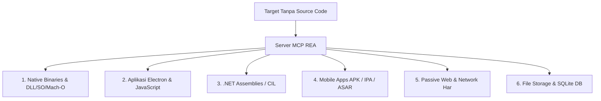

# Panduan Universal REA (Reverse Engineer Anything) untuk Antigravity IDE

Panduan ini mendokumentasikan integrasi **REA** (*Reverse Engineer Anything*) ke dalam ekosistem **Antigravity IDE** melalui perkakas universal [`vibe_tools`](file:///d:/mobog/Videos/Youtube%20Download/vibe_tools).

REA memungkinkan agen AI (Gemini, Claude, GPT) melakukan **rekayasa balik (*reverse engineering*) tingkat lanjut tanpa memerlukan kode sumber (*source code*)** pada berbagai jenis target perangkat lunak.

---

## 1. Status Instalasi & Integrasi MCP

- **Node.js Runtime**: v24.13.0 (Memenuhi syarat REA >=22.19 / >=24.11 / 26+)
- **Paket Global**: `rea-agents` (v6.5.0) terpasang di npm global.
- **Server MCP**: Terdaftar di `~/.gemini/config/mcp_config.json` dengan adapter `production-stdio`.
- **Katalog Tools**: **207 tools** rekayasa balik telah diekstrak dan tersimpan di:
  - Direktori Lokal Submodule: `vibe_tools/mcp_schemas/rea/`
  - Direktori Global IDE: `~/.gemini/antigravity-ide/mcp/rea/`
- **Status Validasi**: `healthy: true` (Tervalidasi via `rea mcp doctor`).

---

## 2. Berkas Perkakas REA di `vibe_tools`

| Berkas | Deskripsi & Fungsi Universal |
| :--- | :--- |
| `install_rea_antigravity.py` | Installer otomatis 1-klik untuk PC/laptop baru: verifikasi Node, pasang paket global, ekstrak 200+ skema MCP, dan daftarkan ke `mcp_config.json`. |
| `rea_tool.py` | CLI & modul Python pembungkus (*wrapper*) untuk mengeksekusi subperintah REA dengan proteksi batas baris keluaran (*token efficiency*). |
| `mcp_schemas/rea/*.json` | Salinan 207 skema JSON alat MCP REA (siap digunakan offline di IDE mana pun). |

---

## 3. Cakupan Analisis & Kemampuan Universal REA

REA dirancang untuk bekerja secara universal di semua proyek pengembangan tanpa terikat pada satu domain aplikasi:



### 1. Native Binaries (Windows PE, Linux ELF, macOS Mach-O)
- Membedah berkas `.exe`, `.dll`, `.so`, dan `.dylib` tanpa decompiler berat.
- Alat utama:
  - `inspect_pe_resources`: Menginspeksi struktur PE, icon, metadata, dan resource section.
  - `inspect_binary_layout`: Mengetahui arsitektur mesin, header, section, dan RVA.
  - `inspect_native_api`: Memetakan fungsi ekspor/impor pustaka native.
  - `search` & `xrefs`: Melacak referensi string atau alamat fungsi penting.

### 2. Aplikasi Desktop JavaScript & Electron
- Mengekstrak dan menganalisis paket `.asar` dan direktori aplikasi Electron tertutup.
- Alat utama:
  - `analyze_javascript_application`: Memetakan modul, dependensi, contextBridge API, dan preload script.
  - `inspect_electron_fuses`: Memeriksa konfigurasi keamanan bawaan aplikasi Electron.
  - `recover_javascript_sources`: Memulihkan kode JavaScript yang di-bundle atau di-minify.

### 3. Rakitan .NET (Managed PE / CLI)
- Membedah assembly C# / VB.NET / F# tanpa eksekusi.
- Alat utama:
  - `inspect_managed_artifact`: Membaca metadata, tipe, signature, dan deklarasi method CIL.
  - `compare_managed_members`: Membandingkan dua rilis binary .NET untuk melihat perubahan API.

### 4. Paket Seluler & Arsip (Android APK, iOS IPA)
- Membedah file APK atau arsip aplikasi seluler.
- Alat utama:
  - `search_android_classes` & `inspect_android_class`: Mencari class dan method Android dalam APK.
  - `trace_android_references`: Melacak relasi pemanggilan antar-class.

### 5. Web & Pengamatan Jaringan Pasif
- Membedah alur request browser dan script halaman web tertutup via loopback Chrome DevTools (CDP).
- Alat utama:
  - `inspect_web_page`: Mengamati struktur DOM dan origin halaman secara pasif.
  - `inspect_web_network_capture`: Menginspeksi berkas rekaman HAR, Fiddler SAZ, atau mitmproxy.

### 6. Basis Data Proyek & SQLite
- Menginspeksi skema file database `.db` atau `.sqlite` yang digunakan oleh software tertutup.
- Alat utama:
  - `inspect_sqlite_database`: Menampilkan daftar tabel, skema kolom, dan sampel baris.

---

## 4. Cara Penggunaan Praktis

### A. Menjalankan Analisis via Python Wrapper (`rea_tool.py`)
Gunakan `rea_tool.py` langsung dari terminal di proyek mana saja:
```powershell
# 1. Memeriksa header dan resource file PE / DLL
python vibe_tools/rea_tool.py inspect-pe-resources "C:\path\to\target.dll" --limit-lines 30

# 2. Menginspeksi tata letak binary native (PE / ELF / Mach-O)
python vibe_tools/rea_tool.py inspect-binary-layout "C:\path\to\target.exe"

# 3. Memeriksa status kesehatan server REA
python vibe_tools/rea_tool.py doctor
```

### B. Mengimpor ke Skrip Python Lain
```python
from vibe_tools.rea_tool import jalankan_rea

# Jalankan analisis dan terima output berupa dictionary Python (JSON parsed)
hasil = jalankan_rea("inspect-pe-resources", "C:/path/to/target.dll")
if isinstance(hasil, dict):
    print("Format biner:", hasil.get("normalized_result", {}).get("format"))
```

### C. Menjalankan Ulang Installer di PC/Laptop Baru
Saat Anda mengklon repositori ke komputer baru:
```powershell
python vibe_tools/install_rea_antigravity.py
```
Skrip akan memastikan Node/npm tersedia, mengunduh `rea-agents`, mengonfigurasi skema MCP, dan memperbarui `mcp_config.json` secara instan.
