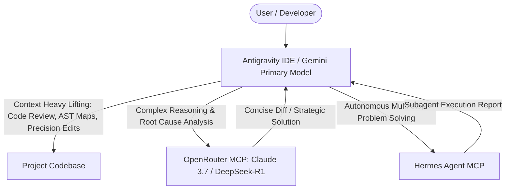

# 🧰 Vibe Tools: Portable Vibe Coding & Agentic MCP Ecosystem

<p align="center">
  <b>A zero-friction, token-efficient developer toolkit for Antigravity IDE and modern AI Agentic workflows.</b>
</p>

<p align="center">
  <a href="README.md">🇮🇩 Baca dalam Bahasa Indonesia</a> •
  <a href="README_EN.md">🇬🇧 Read in English</a>
</p>

---

## 🌟 Overview

**Vibe Tools** is a self-contained, portable suite of automation scripts, Model Context Protocol (MCP) servers, schemas, token-saving guardrails, and agentic skills designed for **Google Antigravity IDE** and modern AI coding environments.

With a single terminal command, Vibe Tools configures a complete, high-performance **Dual-Agent Architecture** in any project without requiring tedious manual setup.

---

## ⚡ 1-Click Quickstart

### Method 1: As a Git Submodule (Recommended)
Add Vibe Tools as a submodule in any project to keep it automatically synchronized:

```bash
# 1. Add the submodule to your project
git submodule add https://github.com/mobogemuichi-creator/vibe-tools.git vibe_tools

# 2. Run the 1-click ecosystem installer
python vibe_tools/setup_vibe_ecosystem.py
```

### Method 2: Standalone / Direct Copy
Simply copy the `vibe_tools/` folder into your project root and run:
```bash
python vibe_tools/setup_vibe_ecosystem.py
```

---

## 🚀 What Happens Automatically in 1 Click?

When you run `setup_vibe_ecosystem.py`, it automatically performs the following:

- [x] **Installs Required Dependencies**: Automatically checks and installs `mcp`, `requests`, `graphifyy`, and Hermes dependencies via `pip`.
- [x] **Configures Antigravity IDE**: Dynamically maps paths in `~/.gemini/config/mcp_config.json` without hardcoded usernames.
- [x] **Installs OpenRouter MCP**: Installs the `openrouter` MCP server (`tanya_openrouter`, `daftar_model_rekomendasi`, `cek_koneksi_openrouter`) supporting Claude 3.7 Thinking, DeepSeek-R1, and custom models.
- [x] **Installs Hermes Agent MCP**: Configures autonomous multi-step subagent delegation (`delegasikan_ke_hermes`).
- [x] **Deploys MCP Schemas**: Installs validated JSON schemas into `~/.gemini/antigravity-ide/mcp/`.
- [x] **Deploys Global Skills**: Deploys the `/graphify` skill to `~/.gemini/config/skills/graphify/SKILL.md`.
- [x] **Synchronizes API Keys**: Auto-detects and synchronizes your `OPENROUTER_API_KEY` across all IDE config files.
- [x] **Scaffolds Guardrails & Architecture**: Generates token-efficient rules in `.agents/AGENTS.md`, modular skills, workflows, and AST file maps (`.agents/MAP.md`).

---

## 🧠 Dual-Agent Architecture

Vibe Tools establishes a collaborative dual-agent paradigm:



1. **Primary Model (Gemini / IDE Agent)**: Handles large context lifting, AST tree inspections, CLI executions, log digestion, and precision code editing.
2. **Deep Reasoning Offload**: Autonomously offloads pure algorithmic problems, root-cause investigations, and architectural decisions to **OpenRouter** (Claude 3.7 Sonnet Thinking / DeepSeek-R1) or **Hermes Agent**.

---

## 📁 Repository Contents

### 🐍 Automation Scripts & MCP Servers
| File | Description |
| :--- | :--- |
| **`setup_vibe_ecosystem.py`** | Master 1-click installer for the entire ecosystem. |
| **`openrouter_mcp.py`** | Dynamic OpenRouter MCP server with smart alias resolution (`r1`, `claude`, `deepseek`, `free`). |
| **`hermes_mcp.py`** | Native bridge server connecting Hermes Agent to Antigravity IDE. |
| **`graphify_sync.py`** | AST code mapping generator and Knowledge Graph synchronization (`--map-only`, `--graph-only`). |
| **`push_to_github.py`** | Safe Git staging, commit, and push utility with file size detection (>50MB/100MB warning). |
| **`install_openrouter_mcp.py`** | Standalone installer for the OpenRouter MCP server. |
| **`install_hermes_antigravity.py`**| Standalone installer for Hermes Agent and bridge tools. |
| **`mcp_schemas/`** | Pre-built offline schema files for Antigravity IDE MCP integration. |

### 📚 Documentation & Prompting Guides
| File | Description |
| :--- | :--- |
| **`PANDUAN_SETUP_VIBE_CODING_BARU.md`** | Step-by-step instructions and ready-to-paste prompts for new projects. |
| **`Prompt_AI.md`** | Curated catalog of token-saving prompting patterns (*Progressive Disclosure*, *Targeted Context Tagging*, *Facade Pattern*). |
| **`OPENROUTER_MCP_GUIDE.md`** | Detailed setup guide for OpenRouter models, daily budget limits, and alias mapping. |
| **`PANDUAN_HERMES_ANTIGRAVITY.md`** | Architectural deep-dive on Hermes Agent integration with Antigravity. |

---

## 🔄 Updating Across Projects

If you update `vibe-tools` in this repository, you can pull the latest tools into any project with a single command:

```bash
git submodule update --remote --merge
```

To edit and push changes from within any project's submodule:
```bash
cd vibe_tools
python push_to_github.py
```

---

## 🤝 Contributing

Contributions are very welcome! Whether it's adding new MCP servers, improving prompt templates, optimizing token usage, or refining setup scripts:

1. **Fork** the repository: [github.com/mobogemuichi-creator/vibe-tools](https://github.com/mobogemuichi-creator/vibe-tools)
2. Create a feature branch: `git checkout -b feature/amazing-tool`
3. Commit your changes: `git commit -m "feat: add amazing tool"`
4. Push to your branch: `git push origin feature/amazing-tool`
5. Open a **Pull Request**.

---

## 📄 License

This project is licensed under the [MIT License](LICENSE) - feel free to use, modify, and distribute it in your own personal and commercial projects.
