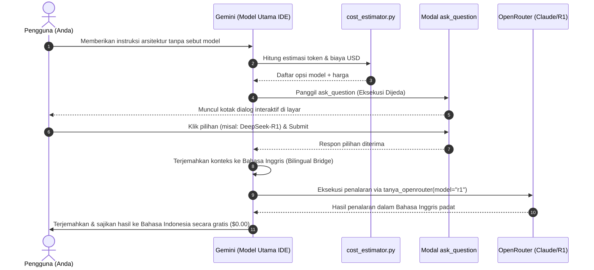

# 🎯 Panduan & Tutorial Pengujian Dialog Interaktif `ask_question`

Dokumen ini berisi panduan praktis dan contoh prompt siap pakai untuk menguji fitur **Interactive Model Selector & Modal Dialog (`ask_question`)** di Antigravity IDE.

---

## 🧭 Apa Itu Tool `ask_question` di Antigravity IDE?

`ask_question` adalah tool antarmuka visual bawaan Antigravity IDE yang berfungsi memunculkan **jendela modal interaktif (radio button/pilihan klik)** di layar pengguna. 

Ketika tool ini dipanggil oleh AI:
1. **Eksekusi Dijeda (Blocked Execution)**: AI berhenti sejenak dan menunggu respon klik dari Anda.
2. **Pilihan Ditampilkan di Layar**: Menampilkan daftar opsi model AI beserta estimasi biaya USD dan token in/out (`cost_estimator.py`).
3. **Respon Diteruskan**: Setelah Anda memilih dan menekan tombol **Submit**, AI akan langsung mengeksekusi tugas sesuai model pilihan Anda.

---

## 🧪 3 Skenario Pengujian Praktis (Siap Copy-Paste)

Anda dapat menguji fitur ini kapan saja di chat Antigravity IDE menggunakan salah satu skenario di bawah ini:

### Skenario 1: Pengujian Simulasi Langsung (Paling Cepat)
Gunakan prompt ini jika Anda hanya ingin melihat dan mencoba mengeklik modal dialog di layar:

```text
Tolong panggil tool ask_question untuk menampilkan pilihan model AI beserta estimasi biayanya untuk pengujian.
```

* **Hasil yang Diharapkan**: Modal dialog pilihan model (DeepSeek-R1, Claude Sonnet 4.5, DeepSeek-V3, Gemini Flash IDE Gratis, Hermes Agent) langsung muncul di tengah layar IDE Anda.

---

### Skenario 2: Pengujian Otomatis Alami (Natural Trigger)
Sesuai aturan di [.agents/AGENTS.md](file:///d:/mobog/Videos/Youtube%20Download/.agents/AGENTS.md), jika Anda meminta tugas penalaran atau arsitektur rumit **tanpa menyebutkan nama model**, AI wajib memunculkan modal `ask_question` terlebih dahulu untuk mencegah pembengkakan saldo OpenRouter tanpa izin.

Contoh prompt:
```text
Tolong rancang arsitektur sinkronisasi multi-threading dan locking protocol untuk download queue agar terhindar dari race condition.
```

* **Hasil yang Diharapkan**:
  1. AI mendeteksi bahwa ini adalah tugas arsitektur kompleks.
  2. Karena Anda tidak menyebutkan model (seperti "pakai claude" atau "pakai r1"), AI menghitung estimasi token melalui `cost_estimator.py`.
  3. AI memunculkan modal dialog `ask_question` agar Anda yang menentukan apakah ingin menggunakan Claude Sonnet (~$0.024), DeepSeek-R1 (~$0.003), atau Gemini Flash Gratis ($0.00).

---

### Skenario 3: Memilih Opsi Kustom (Write-In Option)
Pada modal dialog `ask_question`, Antigravity IDE menyediakan kolom isian bebas (*Write-in text*) di bagian bawah secara default.

1. Jalankan prompt dari **Skenario 1**.
2. Alih-alih memilih tombol radio yang tersedia, ketik instruksi khusus pada kolom input (misal: *"Gunakan model Qwen Coder saja"*).
3. Klik **Submit**.
4. AI akan menerima pesan kustom Anda dan menjalankannya sesuai arahan tersebut.

---

## 🔄 Apa yang Terjadi di Balik Layar Setelah Anda Mengklik?



---

## 🛠️ Troubleshooting

1. **Mengapa modal tidak muncul dan AI langsung mengeksekusi?**
   - Periksa prompt Anda: jika Anda sudah menyebutkan model (misal: *"analisis pakai claude..."* atau *"gunakan r1..."*), AI akan langsung merouting ke model tersebut tanpa memunculkan pertanyaan karena preferensi Anda sudah jelas.
2. **Apakah modal bisa memunculkan checkbox (banyak pilihan)?**
   - Ya. Tool `ask_question` mendukung parameter `is_multi_select: true` jika Anda ingin mengizinkan pemilihan lebih dari satu opsi sekaligus.
3. **Bagaimana jika saya menekan tombol Skip?**
   - Jika Anda menekan tombol **Skip**, AI akan melanjutkan dengan opsi rekomendasi default (*fallback*) atau menggunakan Model Utama IDE Gemini Flash secara gratis.
