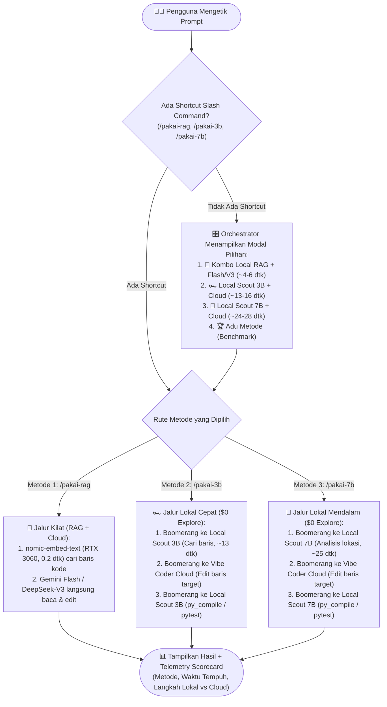

# Spesifikasi Teknis: Arsitektur Hybrid Dual-Cockpit & Pemilih Metode Eksekusi Interaktif (Antigravity + Roo Code + RTX 3060)

**Tanggal**: 28 Oktober 2026 (Revisi v4.0 — Portabilitas Lintas-Proyek via `vibe_tools/setup_roo_hybrid.py` & Pemilih Metode Eksekusi Interaktif)  
**Disusun Oleh**: Gemini 4 Argon (Primary) & DeepSeek-R1 (`deepseek-r1-0528` via OpenRouter)  
**Target Perangkat Keras**: NVIDIA GeForce RTX 3060 Laptop GPU (6.144 MiB Total / ~5.994 MiB VRAM Bebas)  
**Status**: Telah Dieksekusi & Terintegrasi ke `vibe_tools` (`COMPLETED v4.0`)  

---

## 1. Overview & Objectives (Ringkasan & Tujuan)

Dokumen spesifikasi ini mendefinisikan arsitektur **Hybrid Dual-Cockpit + Multi-Engine Selector** yang memungkinkan pengguna melakukan *vibe coding* di **VS Code + Roo Code** dengan biaya **Pay-As-You-Go ultra-hemat (~$1.50–$3.50/bulan melalui OpenRouter + $0 Ollama Lokal)**, sekaligus mempertahankan kompatibilitas 100% dengan **Antigravity IDE (Free Tier)**.

Pada **Revisi v3.0**, ditambahkan fitur **Interactive Execution Method Selector (Pemilih Metode Eksekusi Saat Prompting)** yang memungkinkan pengguna mencoba, memilih, dan membandingkan secara langsung 3 mesin eksekusi kerja kasar setiap kali memberikan prompt:
1. 🚀 **Kombo Local RAG (`nomic-embed-text`) + Cloud (`Gemini 2.5 Flash` / `DeepSeek-V3`)** *(Target durasi: ~4–6 detik)*.
2. 🏎️ **Local Scout 3B (`qwen2.5-coder:3b`) + Cloud Edit** *(Target durasi: ~13–16 detik | Kerja kasar Rp 0)*.
3. 🚜 **Local Scout 7B (`qwen2.5-coder:7b`) + Cloud Edit** *(Target durasi: ~24–28 detik | Kerja kasar Rp 0 akurasi tinggi)*.

---

## 2. Komparasi Konsultasi: Gemini 4 Argon vs DeepSeek-R1

| Aspek Evaluasi | Analisis DeepSeek-R1 (`deepseek-r1-0528`) | Analisis Gemini 4 Argon (Konteks Workspace & Hardware) | Sintesis Keputusan Akhir (v3.0) |
| :--- | :--- | :--- | :--- |
| **Strategi Penghematan Biaya** | Gunakan pola *BYOK + Local Inference (Ollama)* untuk sub-tugas biaya nol, *Prompt Caching* di OpenRouter (`DeepSeek-V3`), serta indeks AST `graphify` untuk memangkas konteks 40K -> 3K token. | Deteksi `nvidia-smi` menunjukkan **5.994 MiB VRAM bebas** di RTX 3060 Laptop (karena Windows/IDE dirender oleh iGPU). Sangat ideal untuk menampung `nomic-embed-text`, `Qwen-3B`, maupun `Qwen-7B`. | **Hybrid Dual-Cockpit** dengan **Pemilih 3 Metode Eksekusi** agar pengguna bisa merasakan langsung perbandingan kecepatan vs penghematan token. |
| **Pengalaman Pemilihan Model (UX)** | Pemisahan rute antara model lokal dan cloud berdasarkan bobot tugas. | Di Roo Code, setiap *Custom Mode* dapat mengunci *API Configuration Profile* yang berbeda. Memisahkan mode `local-scout-3b` dan `local-scout-7b` membuat pergantian model terjadi 100% otomatis tanpa ubah setting manual. | **7 Mode Terintegrasi di `.roomodes`** + **Pre-Flight Modal Selector** + **Shortcut Slash Commands (`/pakai-rag`, `/pakai-3b`, `/pakai-7b`)**. |
| **Mitigasi Kebocoran Token & VRAM** | Setiap putaran *agentic loop* mengirim ulang riwayat konteks; wajib gunakan kompresi konteks dan pemisahan sub-tugas. | MCP `rea` (160+ tools) menyedot ~25.000 token/pesan jika aktif. Selain itu, VRAM 6 GB harus otomatis dikosongkan (`KEEP_ALIVE=5m`) agar tidak bentrok dengan FFmpeg / DaVinci Resolve. | **MCP `rea` OFF secara default**, **Circuit Breaker 2x Gagal** pada LLM Lokal, dan **Auto-Unload VRAM 5 Menit**. |

---

## 3. Rekapitulasi Keputusan Sesi `/grill-me` (Q1–Q7 & Revisi R1–R4)

1. **Target Anggaran & Motivasi (Q1)**: Skema *Pay-As-You-Go* super hemat (**~\$1.50–\$3.50/bulan** via OpenRouter + GPU Lokal \$0).
2. **Pola Arsitektur Environment (Q2)**: **Hybrid Dual-Cockpit** (VS Code Roo Code + Antigravity Free Tier membaca folder `.agents/` yang sama).
3. **Skema Provider & Model Cloud (Q3)**: **Full OpenRouter Multi-Tier** (`DeepSeek-V3` / `Gemini 2.5 Flash` untuk eksekusi, `DeepSeek-R1` untuk *Architect/Grill-Me*, dan `Claude Sonnet` untuk darurat).
4. **Arsitektur Mode & Skill (Q4)**: **Custom Modes di `.roomodes` + Lazy-Load `.agents/skills/`**.
5. **Strategi MCP Server (Q5)**: Aktifkan MCP ringan (`openrouter` dengan limit \$1/hari & `hermes_agent`) dan nonaktifkan MCP berat (`rea`) secara *default* di `.roo/mcp.json`.
6. **Sabuk Pengaman Konteks (Q6)**: **Triple-Layer Token Guardrail** (Batas baca 100 baris + prioritas `.agents/MAP.md` & `graphify-out/`, Boomerang Subtask reset, dan *English Bridge Pipeline*).
7. **Cakupan Deliverables (Q7)**: Paket lengkap portabel di level workspace (`.roomodes`, `.roo/rules/`, `.roo/commands/`, `.roo/mcp.json`).
8. **Fitur Pemilih Metode Eksekusi Langsung Saat Prompting (Revisi v3.0)**:
   - Menyediakan **3 metode kerja kasar** yang dapat dipilih langsung saat prompting (`Kombo Local RAG + Flash/V3`, `Local Scout 3B`, dan `Local Scout 7B`) melalui **Tombol Pilihan Interaktif (Modal)** maupun **Slash Commands Cepat**, lengkap dengan **Kartu Skor Kecepatan & Token** di akhir respons.

---

## 4. Desain Fitur "Interactive Execution Method Selector" (Pemilih Metode Saat Prompting)

Agar Anda dapat menjajal dan membandingkan ketiga metode secara langsung tanpa perlu membuka menu *Settings* Roo Code, sistem menyediakan **3 Cara Pemilihan Instan**:

### 4.1. Cara 1: Modal Pilihan Interaktif Otomatis (1-Klik Saat Prompting)
Saat Anda berada di mode **`🪃 Orchestrator (Boomerang)`** dan mengetikkan tugas koding/eksplorasi baru tanpa menyebutkan metode spesifik, `Orchestrator` akan langsung menampilkan tombol pilihan (`ask_followup_question` di Roo Code / `ask_question` di Antigravity):

> **Pilih Metode Eksekusi untuk Tugas Ini:**
> 1. 🚀 **Kombo Local RAG (`nomic-embed`) + Gemini Flash / DeepSeek-V3** *(~4–6 dtk | Pencarian Vektor Lokal 0,2 dtk + Eksekusi Cloud Instan)*
> 2. 🏎️ **Local Scout 3B (`qwen2.5-coder:3b`) + Cloud Edit** *(~13–16 dtk | Kerja Kasar Explore & Test Rp 0 — Ringan 2,2 GB VRAM)*
> 3. 🚜 **Local Scout 7B (`qwen2.5-coder:7b`) + Cloud Edit** *(~24–28 dtk | Kerja Kasar Explore & Test Rp 0 — Akurasi Tinggi 4,8 GB VRAM)*
> 4. 🏆 **Mode Benchmark / Adu Cepat** *(Uji eksplorasi & tampilkan perbandingan waktu nyata ketiganya)*

### 4.2. Cara 2: Shortcut Slash Command Langsung di Ketikan Prompt (`.roo/commands/`)
Jika Anda ingin langsung memotong kompas tanpa melewati pertanyaan modal, cukup awali prompt Anda dengan salah satu *slash command* berikut:
* **`/pakai-rag <instruksi tugas>`**: Langsung memicu pencarian semantik lokal `codebase_search` (`nomic-embed-text` di RTX 3060) + pembacaan `.agents/MAP.md`, lalu mengeksekusi tugas menggunakan `Gemini 2.5 Flash` / `DeepSeek-V3` dalam 1 langkah cepat.
* **`/pakai-3b <instruksi tugas>`**: Langsung mendelegasikan tahap *Explore/Search* dan *Test/Compile Run* ke sub-agen **`🏎️ Local Scout 3B`** (`qwen2.5-coder:3b`).
* **`/pakai-7b <instruksi tugas>`**: Langsung mendelegasikan tahap *Explore/Search* dan *Test/Compile Run* ke sub-agen **`🚜 Local Scout 7B`** (`qwen2.5-coder:7b`).
* **`/adu-metode <instruksi eksplorasi>`**: Menjalankan uji eksplorasi terisolasi secara berurutan pada metode `RAG + Flash/V3`, `Local Scout 3B`, dan `Local Scout 7B`, lalu mencetak tabel perbandingan waktu tempuh dan akurasi baris yang ditemukan.

### 4.3. Cara 3: Kartu Skor Kecepatan & Biaya (*Execution Telemetry Badge*)
Di setiap akhir penyelesaian tugas, agen diwajibkan menampilkan baris telemetri ringkas agar Anda bisa merasakan perbedaannya secara objektif:

```markdown
---
⏱️ **Telemetry Eksekusi**:
• **Metode Aktif**: 🏎️ Local Scout 3B + DeepSeek-V3
• **Kerja Kasar Lokal ($0)**: 2 aksi (Grep + py_compile via `qwen2.5-coder:3b`)
• **Eksekusi Cloud**: 1 aksi (Edit 35 baris via `deepseek-chat-v3`)
• **Status VRAM RTX 3060**: ~2.2 GB (Auto-Unload ke 0 MB dalam 5 menit)
```

---

## 5. Interface Contracts & Struktur Konfigurasi Target (v3.0)

### 5.1. Peta Direktori Hybrid Dual-Cockpit
Tidak ada file Python (`.py`) yang disentuh atau diubah. Seluruh integrasi berupa file konfigurasi deklaratif:

```text
d:\mobog\Videos\Youtube Download\
├── .agents/                          # [EXISTING - SINGLE SOURCE OF TRUTH]
│   ├── AGENTS.md                     # Aturan utama workspace
│   ├── MAP.md                        # Peta modul codebase
│   └── skills/                       # Katalog skill (video-pipeline, pyinstaller, dll.)
├── .roomodes                         # [NEW] Definisi 7 Custom Modes (5 Cloud + 2 Local GPU 3B & 7B)
├── .roo/                             # [NEW] Direktori konfigurasi khusus Roo Code
│   ├── mcp.json                      # Konfigurasi MCP (openrouter: ON, hermes: ON, rea: OFF)
│   ├── rules/                        # Aturan global Roo Code (mengacu ke .agents/AGENTS.md)
│   │   ├── 01-core-identity.md       # Bahasa Indonesia, Model Transparency, Telemetry Badge
│   │   ├── 02-token-guardrails.md    # Max 100 lines, Graphify/RAG-first, English Bridge
│   │   └── 03-clean-architecture.md  # Max 300 baris/file, modular layering, docstring ID
│   ├── rules-orchestrator/           # [NEW] Aturan Pemilih Metode Eksekusi (Modal 3 Opsi)
│   │   └── execution-selector.md     # Logika pemilihan RAG+Cloud vs Scout 3B vs Scout 7B
│   ├── rules-grill-me-spec/          # Aturan khusus Mode Grill-Me (Dilarang sentuh .py!)
│   │   └── strict-consultation.md
│   ├── rules-local-scout-3b/         # [NEW] Prompt ultra-ringkas khusus Qwen2.5-Coder 3B
│   │   └── fast-local-worker.md
│   ├── rules-local-scout-7b/         # [NEW] Prompt ultra-ringkas khusus Qwen2.5-Coder 7B
│   │   └── deep-local-worker.md
│   └── commands/                     # Slash Commands kompatibel Roo Code
│       ├── pakai-rag.md              # [NEW] /pakai-rag (Metode 1: Local RAG + Gemini Flash/V3)
│       ├── pakai-3b.md               # [NEW] /pakai-3b  (Metode 2: Local Scout 3B + Cloud Edit)
│       ├── pakai-7b.md               # [NEW] /pakai-7b  (Metode 3: Local Scout 7B + Cloud Edit)
│       ├── adu-metode.md             # [NEW] /adu-metode (Benchmark langsung ke-3 metode)
│       ├── grill-me.md               # /grill-me (Wawancara 1-per-1 via ask_followup_question)
│       ├── to-spec.md                # /to-spec (Konversi hasil diskusi ke docs/specs/*.md)
│       ├── to-tickets.md             # /to-tickets (Pecah spec menjadi tiket Boomerang)
│       ├── tdd.md                    # /tdd (Siklus Red-Green-Refactor ketat)
│       ├── modular-refactor.md       # /modular-refactor (Pecah file > 300 baris)
│       └── handoff.md                # /handoff (Kompresi sesi untuk ganti chat)
└── docs/
    └── specs/
        └── roo-code-hybrid-migration.md  # [DOKUMEN INI]
```

### 5.2. Kontrak 7 Mode di `.roomodes` (Mendukung Penguncian Profil Model Otomatis)

Dengan memisahkan `local-scout-3b` dan `local-scout-7b` menjadi 2 mode tersendiri, Roo Code dapat menyimpan **API Profile terpisah** untuk masing-masing mode (sehingga berganti antara 3B, 7B, dan Cloud terjadi otomatis saat mode berpindah):

| Slug Mode | Nama Tampilan di Roo Code | Profil API & Model yang Dikunci | Izin Tools (`groups`) | Peran & Kontrak Utama |
| :--- | :--- | :--- | :--- | :--- |
| `orchestrator` | **🪃 Orchestrator (Selector)** | **OpenRouter**: `google/gemini-2.5-flash` atau `deepseek/deepseek-chat-v3` | `read`, `mcp` | Menanyakan pilihan metode eksekusi (`RAG+Flash` vs `Scout 3B` vs `Scout 7B`) jika belum disebut di prompt, lalu mengorkestrasi *Boomerang Subtask* sesuai pilihan pengguna. |
| `local-scout-3b` | **🏎️ Local Scout 3B (Fast \$0)** | **Ollama Lokal**: `qwen2.5-coder:3b-instruct` (~2,2 GB VRAM) | **`read`, `command` SAJA** | **Pekerja Kasar Cepat (\$0)**: Kecepatan ~80 token/dtk (~13–16 dtk/tugas). Melakukan `search_files`, `codebase_search`, `py_compile`, `pytest -q`, dan kompresi log. |
| `local-scout-7b` | **🚜 Local Scout 7B (Deep \$0)** | **Ollama Lokal**: `qwen2.5-coder:7b-instruct-q4_K_M` (~4,8 GB VRAM) | **`read`, `command` SAJA** | **Pekerja Kasar Akurat (\$0)**: Kecepatan ~45 token/dtk (~24–28 dtk/tugas). Melakukan penelusuran lintas-file yang lebih kompleks dan analisis log error secara gratis. |
| `vibe-coder` | **💻 Vibe Coder (Cloud Exec)** | **OpenRouter**: `deepseek/deepseek-chat-v3` / `gemini-2.5-flash` | `read`, `edit`, `command`, `mcp` | Mengeksekusi penulisan/edit kode (<300 baris/file). Pada metode **Kombo Local RAG**, mode ini langsung menggunakan `codebase_search` (`nomic-embed-text`) + edit dalam 1 langkah kilat (~4–6 dtk). |
| `grill-me-spec` | **🔥 Grill-Me & Spec (Architect)** | **OpenRouter**: `deepseek/deepseek-r1` | `read`, `mcp`, `edit` (**Hanya `docs/**/*.md`** — `.py` diblokir `fileRegex`) | Wawancara interaktif 1-per-1 (`ask_followup_question`) dan penulisan spesifikasi ke `docs/specs/*.md`. **Diblokir secara teknis dari menyentuh `.py`**. |
| `bug-hunter` | **🔍 Bug Hunter (Diagnose)** | **OpenRouter**: `deepseek/deepseek-chat-v3` + konsultasi `r1` | `read`, `edit`, `command`, `mcp` | Reproduksi bug dengan tes terisolasi terlebih dahulu sebelum memperbaiki kode produksi. |
| `code-reviewer` | **🛡️ Code Reviewer (Audit)** | **OpenRouter**: `deepseek/deepseek-r1` / `deepseek-chat-v3` | `read`, `command`, `mcp` (Read-only) | Audit kepatuhan Clean Architecture (<300 baris, *type hinting*, *docstring* Bahasa Indonesia, keamanan kredensial). |

---

## 6. Alur Kerja Pemilih Metode Eksekusi (Flowchart v3.0)



---

## 7. Boundary, Error Matrix & Architectural Guardrails

| Skenario / Risiko | Perilaku Pengaman (Guardrail) | Mekanisme Penanganan di Roo Code |
| :--- | :--- | :--- |
| **Agen mencoba mengubah file `.py` saat sesi konsultasi `/grill-me`** | **Hard Regex Lock pada `.roomodes`** | Pada mode `grill-me-spec`, izin grup `edit` dibatasi dengan properti `fileRegex: "^docs/.*\\.md$"`. Segala percobaan edit `.py` otomatis ditolak oleh mesin Roo Code. |
| **Pergantian antara `Local Scout 3B` dan `Local Scout 7B` di VRAM 6 GB** | **Automatic Model Swapping oleh Ollama** | Dengan `OLLAMA_MAX_LOADED_MODELS=2` (1 Embed + 1 Chat), saat pengguna beralih dari `/pakai-3b` ke `/pakai-7b`, Ollama otomatis menurunkan model 3B dari VRAM dan memuat model 7B tanpa risiko *Out-of-Memory*. |
| **Model Lokal (3B/7B) gagal memformat XML tool atau berputar-putar (*looping*)** | **2-Strike Circuit Breaker** | Di dalam `.roo/rules-local-scout-3b/` dan `7b/`, pekerja lokal dibatasi maksimal **3 langkah baca/eksekusi**. Jika gagal 2x berturut-turut, ia wajib segera memanggil `attempt_completion` dengan status `[FALLBACK_TO_CLOUD]` agar `Orchestrator` langsung mengoper ke jalur **Metode 1 (`RAG + Flash/V3`)**. |
| **Skema MCP `rea` (160+ tools) menguras 25.000 token per chat** | **Default Disabled di `.roo/mcp.json`** | Di dalam `.roo/mcp.json`, server `rea` diberi atribut `"disabled": true` secara bawaan. Pengguna cukup menggeser tombol *toggle* di UI Roo Code hanya saat melakukan *reverse engineering*. |

---

## 8. Arsitektur Portabilitas Lintas-Proyek (`vibe_tools/setup_roo_hybrid.py` — Revisi v4.0)

Berdasarkan sesi `/grill-me` lanjutan (Q1–Q4), seluruh ekosistem Roo Code Hybrid ini dipaketkan secara modular ke dalam [`vibe_tools/`](file:///d:/mobog/Videos/Youtube%20Download/vibe_tools) agar dapat dipasang dan diperbarui di proyek mana pun dalam 1 detik:

1. **Struktur Template Master (`vibe_tools/roo_hybrid/templates/`)**:
   - Menyimpan master `.roomodes`, `.roo/rules/01-03*.md`, `.roo/rules-*/`, dan `.roo/commands/*.md` secara terpisah sehingga skrip installer tetap ramping (<220 baris, mematuhi batas Clean Architecture <300 baris).
2. **Mekanisme *Smart Managed Copy & Update* (`vibe_tools/setup_roo_hybrid.py`)**:
   - **Auto-Update File Universal**: Saat dijalankan ulang di proyek lama/baru, file universal otomatis diperbarui mengikuti versi terbaru `vibe_tools`.
   - **Proteksi Aturan Spesifik Proyek**: File `.roo/rules/99-project-custom.md` dan `.agents/AGENTS.md` **100% dilindungi (tidak pernah ditimpa)**.
   - **Generator `.roo/mcp.json` Bebas Kredensial**: Otomatis mendeteksi path `sys.executable` dan skrip MCP di `~/.gemini/` tanpa menulis `OPENROUTER_API_KEY` mentah di dalam `.roo/mcp.json` (aman dari kebocoran Git).
3. **Perintah CLI Lintas-Proyek**:
   - Pasang/Update di proyek saat ini: `python vibe_tools/setup_roo_hybrid.py`
   - Pasang/Update langsung ke proyek lain: `python vibe_tools/setup_roo_hybrid.py --target "D:/Path/Ke/ProyekLain"`
   - Konfigurasi VRAM 6 GB & tarik model Ollama (opsional): `python vibe_tools/setup_roo_hybrid.py --setup-ollama`
   - Terintegrasi otomatis ke dalam master installer `python vibe_tools/setup_vibe_ecosystem.py`.
