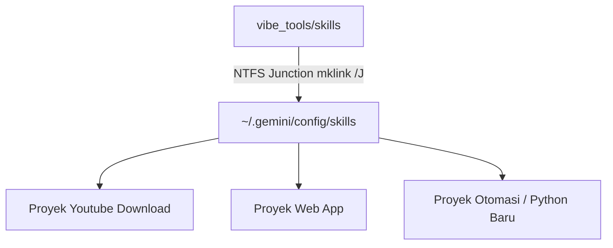
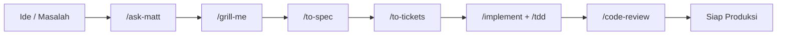

# 🧰 Katalog Lengkap 15 Skill Universal (Vibe Tools x Matt Pocock)

> **Status:** Terhubung secara Global ke `~/.gemini/config/skills` via Windows NTFS Junction  
> **Kompatibilitas:** Antigravity IDE, Claude Code, & Sistem Ekosistem Vibe Coding  
> **Bahasa & Standar:** Dokumentasi Bahasa Indonesia, Guardrails Hemat Token, Zero Regression

---

## 📑 Daftar Isi

1. [Arsitektur & Cara Kerja Skill Universal](#1-arsitektur--cara-kerja-skill-universal)
2. [Peta Alur Rekayasa (The Engineering Spine)](#2-peta-alur-rekayasa-the-engineering-spine)
3. [Katalog Rinci 15 Skill](#3-katalog-rinci-15-skill)
   - [01. /ask-matt (Skill Router)](#01-ask-matt-skill-router)
   - [02. /grill-me (Wawancara Desain Interaktif)](#02-grill-me-wawancara-desain-interaktif)
   - [03. /grill-with-docs (Domain Modeling & ADR)](#03-grill-with-docs-domain-modeling--adr)
   - [04. /to-spec (Penyusun Spesifikasi Formal)](#04-to-spec-penyusun-spesifikasi-formal)
   - [05. /to-tickets (Pemecah Tiket Modular)](#05-to-tickets-pemecah-tiket-modular)
   - [06. /implement (Eksekutor Tiket Disiplin)](#06-implement-eksekutor-tiket-disiplin)
   - [07. /tdd (Test-Driven Development)](#07-tdd-test-driven-development)
   - [08. /diagnosing-bugs (Pelacak Bug Ilmiah)](#08-diagnosing-bugs-pelacak-bug-ilmiah)
   - [09. /code-review (Penilai Kode 3-Sumbu)](#09-code-review-penilai-kode-3-sumbu)
   - [10. /ponytail (Anti-Over-Engineering & Deep Modules)](#10-ponytail-anti-over-engineering--deep-modules)
   - [11. /modular-refactor (Pemecah Modul Monolit)](#11-modular-refactor-pemecah-modul-monolit)
   - [12. /unit-test-generator (Generator Unit Test Pytest)](#12-unit-test-generator-generator-unit-test-pytest)
   - [13. /graphify (Peta Pengetahuan AST & GraphRAG)](#13-graphify-peta-pengetahuan-ast--graphrag)
   - [14. /handoff (Kompaktor Konteks Sesi)](#14-handoff-kompaktor-konteks-sesi)
   - [15. /retro (Retrospeksi Pasca-Tugas)](#15-retro-retrospeksi-pasca-tugas)
4. [Tabel Ringkas Perintah & Rekomendasi Prompt](#4-tabel-ringkas-perintah--rekomendasi-prompt)

---

## 1. Arsitektur & Cara Kerja Skill Universal

Folder `vibe_tools/skills` bertindak sebagai **Single Source of Truth** untuk seluruh perintah cerdas yang dapat dipanggil oleh AI Agent.

- **Otomatis & Tanpa Copy-Paste**: Skill yang Anda simpan di folder ini langsung dikenali oleh seluruh workspace/proyek di PC tanpa perlu menyalin folder `.agents`.
- **Hemat Token**: Setiap instruksi skill dilengkapi panduan pemotongan konteks (sliced reading maks 100 baris, dilarang dump file mentah).
- **Format Standar Antigravity**: Menggunakan YAML Frontmatter valid (`name` dan `description`) sehingga terdeteksi secara native oleh sistem autocomplete slash command.

---

## 2. Peta Alur Rekayasa (The Engineering Spine)

Alur kerja profesional dari ide mentah hingga kode yang siap rilis:

---

## 3. Katalog Rinci 15 Skill

---

### 01. `/ask-matt` (Skill Router)
* **Berkas Definisi**: [ask-matt/SKILL.md](file:///d:/mobog/Videos/Youtube%20Download/vibe_tools/skills/ask-matt/SKILL.md)
* **Tujuan**: Membantu pengguna memilih skill atau alur kerja yang paling tepat saat Anda bingung langkah apa yang harus diambil selanjutnya.
* **Kapan Digunakan**:
  - Saat Anda memiliki masalah atau fitur baru tetapi tidak yakin harus mulai dari mana.
  - Untuk memetakan kebutuhan Anda ke tahapan rekayasa perangkat lunak.
* **Contoh Prompt Pengguna**:
  > *"Aku ingin membuat fitur auto-subtitles otomatis dari file audio, tapi kodenya masih berantakan dan belum ada arsitekturnya. /ask-matt langkah apa yang harus aku jalankan?"*
* **Apa yang Dilakukan AI**:
  - Menganalisis tahapan proyek Anda saat ini.
  - Menampilkan rekomendasi berurutan: misalnya mengarahkan ke `/grill-me` terlebih dahulu untuk membedah dependensi, lalu `/to-spec`, baru kemudian `/implement`.
* **Output**: Panduan navigasi alur kerja bertahap.

---

### 02. `/grill-me` (Wawancara Desain Interaktif)
* **Berkas Definisi**: [grill-me/SKILL.md](file:///d:/mobog/Videos/Youtube%20Download/vibe_tools/skills/grill-me/SKILL.md)
* **Tujuan**: Mewawancarai pengguna secara sistematis (satu pertanyaan per giliran) menggunakan modal interaktif `ask_question` untuk membongkar asumsi, skenario kegagalan, dan keputusan arsitektur sebelum menulis kode.
* **Kapan Digunakan**:
  - Sebelum memulai refactoring besar atau membuat fitur baru yang rumit.
  - Untuk menghindari kesalahan asumsi AI yang bisa merusak kode yang sudah stabil.
* **Contoh Prompt Pengguna**:
  > *"/grill-me tolong interogasi rencanaku membuat sistem ekspor otomatis timeline DaVinci Resolve ke format video TikTok vertikal."*
* **Apa yang Dilakukan AI**:
  - Tidak langsung menulis kode.
  - Memeriksa kode yang ada terlebih dahulu.
  - Memunculkan modal dialog `ask_question` berisi opsi terkompresi dengan rekomendasi default `(Recommended)` satu per satu (misal: penanganan resolusi, pemotongan caption, format audio).
* **Output**: Konsensus arsitektur yang solid dan bebas error.

---

### 03. `/grill-with-docs` (Domain Modeling & ADR)
* **Berkas Definisi**: [grill-with-docs/SKILL.md](file:///d:/mobog/Videos/Youtube%20Download/vibe_tools/skills/grill-with-docs/SKILL.md)
* **Tujuan**: Menyelaraskan istilah domain bisnis (*Domain Glossary*) dan mendokumentasikan keputusan teknis besar ke dalam *Architectural Decision Record* (ADR).
* **Kapan Digunakan**:
  - Saat proyek memiliki istilah teknis yang ambigu (misal: perbedaan `clip`, `timeline_item`, `cut`, `section`).
  - Ketika membuat keputusan permanen (misal: memilih database SQLite vs file JSON).
* **Contoh Prompt Pengguna**:
  > *"/grill-with-docs tolong rapikan istilah domain audio marker dan daftarkan ADR untuk mekanisme caching transkripsi audio."*
* **Apa yang Dilakukan AI**:
  - Mengajukan pertanyaan klarifikasi batas domain.
  - Membuat atau memperbarui berkas `docs/GLOSSARY.md`.
  - Membuat berkas ADR di `docs/adr/000X-pilihan-arsitektur.md`.
* **Output**: Berkas `GLOSSARY.md` dan arsip keputusan ADR resmi.

---

### 04. `/to-spec` (Penyusun Spesifikasi Formal)
* **Berkas Definisi**: [to-spec/SKILL.md](file:///d:/mobog/Videos/Youtube%20Download/vibe_tools/skills/to-spec/SKILL.md)
* **Tujuan**: Mengubah deskripsi santai / ide kasar pengguna menjadi dokumen spesifikasi teknis formal yang terstandarisasi.
* **Kapan Digunakan**:
  - Setelah sesi `/grill-me` selesai dan sebelum membagi tugas.
  - Untuk mengunci kontrak fungsi, tipe data, skenario error, dan kriteria penerimaan.
* **Contoh Prompt Pengguna**:
  > *"/to-spec buatkan spesifikasi teknis lengkap untuk modul auto-split YouTube Shorts berdasarkan hasil diskusi tadi."*
* **Apa yang Dilakukan AI**:
  - Menghasilkan dokumen Markdown berisi ringkasan fungsional, interface contracts (type hints lengkap), data flow, error matrix, dan acceptance criteria.
* **Output**: Artefak dokumen spesifikasi (misal: `docs/specs/auto_split_shorts.md` atau `implementation_plan.md`).

---

### 05. `/to-tickets` (Pemecah Tiket Modular)
* **Berkas Definisi**: [to-tickets/SKILL.md](file:///d:/mobog/Videos/Youtube%20Download/vibe_tools/skills/to-tickets/SKILL.md)
* **Tujuan**: Memecah dokumen spesifikasi teknis menjadi tiket-tiket kerja kecil yang berurutan, terisolasi, dan mudah diuji.
* **Kapan Digunakan**:
  - Setelah spesifikasi teknis disetujui.
  - Mencegah AI mengerjakan terlalu banyak hal sekaligus yang memicu *context exhaustion*.
* **Contoh Prompt Pengguna**:
  > *"/to-tickets tolong pecah spec auto-split shorts ini menjadi tiket kerja terurut dengan batas maksimal 100 baris kode per tiket."*
* **Apa yang Dilakukan AI**:
  - Mengurutkan dependensi: Modul Config/Model $\rightarrow$ Modul Logika Inti $\rightarrow$ Bridge API/Subprocess $\rightarrow$ Integrasi GUI.
  - Setiap tiket memiliki ID, target berkas, kriteria verifikasi, dan budget token.
* **Output**: Daftar tiket rekayasa (`[TICKET-01]`, `[TICKET-02]`, dst).

---

### 06. `/implement` (Eksekutor Tiket Disiplin)
* **Berkas Definisi**: [implement/SKILL.md](file:///d:/mobog/Videos/Youtube%20Download/vibe_tools/skills/implement/SKILL.md)
* **Tujuan**: Mengeksekusi tiket rekayasa satu per satu menggunakan penggantian baris terlokalisasi (`replace_file_content`), mematuhi aturan <300 baris, dan menulis docstring Bahasa Indonesia.
* **Kapan Digunakan**:
  - Saat mulai mengoding berdasarkan tiket yang telah disiapkan.
* **Contoh Prompt Pengguna**:
  > *"/implement tolong kerjakan [TICKET-01]: Scaffold konfigurasi dan tipe data shorts."*
* **Apa yang Dilakukan AI**:
  - Membaca hanya berkas terkait secara terpotong (*sliced view*).
  - Melakukan edit presisi tanpa menimpa seluruh berkas.
  - Memverifikasi batasan baris (<300 baris) dan memastikan docstring dwibahasa/Bahasa Indonesia terpasang.
* **Output**: Perubahan kode bersih yang siap diuji.

---

### 07. `/tdd` (Test-Driven Development)
* **Berkas Definisi**: [tdd/SKILL.md](file:///d:/mobog/Videos/Youtube%20Download/vibe_tools/skills/tdd/SKILL.md)
* **Tujuan**: Menerapkan siklus disiplin *Red-Green-Refactor* menggunakan `pytest`.
* **Kapan Digunakan**:
  - Saat membuat algoritma perhitungan, parsing file teks/SRT, atau logika bisnis yang kritis.
* **Contoh Prompt Pengguna**:
  > *"/tdd buatkan fungsi kalkulasi durasi silence audio dengan pendekatan test-first."*
* **Apa yang Dilakukan AI**:
  1. **Red**: Menulis tes unit di `tests/test_silence.py` dan memastikan tes gagal.
  2. **Green**: Menulis kode minimal yang membuat tes tersebut lolos.
  3. **Refactor**: Merapikan arsitektur dan penamaan tanpa merusak tes.
* **Output**: Tes unit yang lulus 100% dan implementasi fungsi yang solid.

---

### 08. `/diagnosing-bugs` (Pelacak Bug Ilmiah)
* **Berkas Definisi**: [diagnosing-bugs/SKILL.md](file:///d:/mobog/Videos/Youtube%20Download/vibe_tools/skills/diagnosing-bugs/SKILL.md)
* **Tujuan**: Mendiagnosis bug secara ilmiah dengan cara mereproduksinya ke dalam tes unit yang gagal terlebih dahulu sebelum menyentuh kode produksi.
* **Kapan Digunakan**:
  - Saat ada laporan error runtime, crash, atau perilaku yang tidak sesuai ekspektasi.
  - Menghindari perbaikan tebak-tebak buah manggis (*phantom fixes*).
* **Contoh Prompt Pengguna**:
  > *"/diagnosing-bugs saat transkrip SRT kosong, script download_srt_json_v2.py menghasilkan KeyError: 'subtitles'."*
* **Apa yang Dilakukan AI**:
  - Menelusuri alur pemanggilan (call stack).
  - Membuat tes isolasi `tests/test_bug_empty_srt.py` yang mereproduksi `KeyError` tersebut.
  - Memperbaiki kode produksi sampai tes tersebut berubah menjadi hijau.
  - Memberikan ringkasan post-mortem penyebab bug.
* **Output**: Tes reproduksi bug, kode perbaikan terverifikasi, dan analisis akar masalah.

---

### 09. `/code-review` (Penilai Kode 3-Sumbu)
* **Berkas Definisi**: [code-review/SKILL.md](file:///d:/mobog/Videos/Youtube%20Download/vibe_tools/skills/code-review/SKILL.md)
* **Tujuan**: Melakukan audit kode mendalam pada tiga sumbu: kepatuhan arsitektur (<300 baris, docstrings, type hinting), kesesuaian fungsional terhadap tiket, dan audit anti-over-engineering Ponytail (stdlib reuse, cegah class/file prematur).
* **Kapan Digunakan**:
  - Sebelum melakukan commit atau menyelesaikan tiket kerja.
  - Untuk mendeteksi *code smells*, abstraksi berlebihan, atau regresi sedini mungkin.
* **Contoh Prompt Pengguna**:
  > *"/code-review tolong tinjau perubahan terakhir pada file gui/tabs/tab_subtitles.py."*
* **Apa yang Dilakukan AI**:
  - Memeriksa batas panjang modul dan layering.
  - Memeriksa apakah ada penulisan ulang standard library atau pembuatan class pembungkus yang tidak perlu.
  - Memberikan laporan review dengan label: `[CRITICAL]`, `[WARNING]`, dan `[SUGGESTION]`.
* **Output**: Laporan audit mutu kode 3-sumbu.

---

### 10. `/ponytail` (Anti-Over-Engineering & Deep Modules)
* **Berkas Definisi**: [ponytail/SKILL.md](file:///d:/mobog/Videos/Youtube%20Download/vibe_tools/skills/ponytail/SKILL.md)
* **Tujuan**: Mencegah AI menulis kode bertele-tele (*over-engineering*) melalui 7 Tangga Keputusan (YAGNI, utamakan standard library Python, dilarang buat file baru jika <250 baris), sekaligus mempertahankan prinsip *Deep Modules*.
* **Kapan Digunakan**:
  - Saat Anda ingin AI menyederhanakan kode yang terlalu rumit.
  - Secara otomatis aktif pada mode `full` saat menjalankan `/to-spec` dan `/implement`.
* **Contoh Prompt Pengguna**:
  - `"/ponytail sederhanakan fungsi pemotong audio ini agar pakai bawaan Python saja"`
  - `"/ponytail ultra pangkas semua class wrapper yang tidak perlu"`
* **Apa yang Dilakukan AI**:
  - Menjalankan 7 Tangga Keputusan Ponytail (lite/full/ultra).
  - Mengeliminasi dependensi eksternal tak perlu dan menggunakan pustaka bawaan Python.
  - Memastikan kode tetap berada di file asal jika ukuran file masih < 250 baris.
* **Output**: Implementasi kode yang bersih, ringkas, dan bebas abstraksi berlebih.

---

### 11. `/modular-refactor` (Pemecah Modul Monolit)
* **Berkas Definisi**: [modular-refactor/SKILL.md](file:///d:/mobog/Videos/Youtube%20Download/vibe_tools/skills/modular-refactor/SKILL.md)
* **Tujuan**: Memecah script Python monolitik yang sudah melampaui batas batas (>300 baris) menjadi sub-package modular dengan jaminan *zero-regression*.
* **Kapan Digunakan**:
  - Saat mendapati modul besar (seperti script legacy 500-2000 baris).
* **Contoh Prompt Pengguna**:
  > *"/modular-refactor tolong pecah file download_srt_json_v2.py yang berukuran 690 baris menjadi sub-package terstruktur."*
* **Apa yang Dilakukan AI**:
  - Menelusuri graf ketergantungan fungsi.
  - Membangun sub-package: `config.py`, `bridge.py`, `processor.py`.
  - Mempertahankan berkas asli sebagai *facade* (`from subpackage import ...`) agar script lain yang memanggilnya tidak error.
* **Output**: Struktur modul baru di bawah 300 baris per file dan facade kompatibilitas ke belakang.

---

### 12. `/unit-test-generator` (Generator Unit Test Pytest)
* **Berkas Definisi**: [unit-test-generator/SKILL.md](file:///d:/mobog/Videos/Youtube%20Download/vibe_tools/skills/unit-test-generator/SKILL.md)
* **Tujuan**: Membuat suite pengujian unit berbasis `pytest` dengan teknik *strict mocking* (mengisolasi internet, subprocess FFmpeg, dan SDK DaVinci Resolve).
* **Kapan Digunakan**:
  - Menambahkan pengujian otomatis pada fungsi-fungsi yang berinteraksi dengan API eksternal atau file biner.
* **Contoh Prompt Pengguna**:
  > *"/unit-test-generator buatkan unit test untuk modul sync_sentence_to_word.py lengkap dengan mock file srt."*
* **Apa yang Dilakukan AI**:
  - Membuat berkas `tests/test_sync_sentence.py`.
  - Menggunakan fixture `tmp_path`, `unittest.mock.patch`, dan `MagicMock` sehingga tes berjalan instan tanpa koneksi internet.
* **Output**: Berkas pengujian unit terisolasi yang siap dijalankan dengan `pytest`.

---

### 13. `/graphify` (Peta Pengetahuan AST & GraphRAG)
* **Berkas Definisi**: [graphify/SKILL.md](file:///d:/mobog/Videos/Youtube%20Download/vibe_tools/skills/graphify/SKILL.md)
* **Tujuan**: Mengubah seluruh basis kode menjadi graf pengetahuan terstruktur (*Knowledge Graph*) berbasis AST, menghasilkan laporan interaktif, dan memungkinkan query GraphRAG.
* **Kapan Digunakan**:
  - Saat Anda baru pertama kali menjelajahi proyek besar.
  - Mencari jalur pemanggilan fungsi (`call paths`) atau mencari tahu siapa yang memanggil fungsi tertentu.
* **Contoh Prompt Pengguna**:
  > *"/graphify jalankan ekstraksi graph untuk modul gui/ dan tampilkan fungsi apa saja yang paling banyak dipanggil."*
* **Apa yang Dilakukan AI**:
  - Menjalankan pipeline Graphify.
  - Menghasilkan `graphify-out/graph.json` dan `GRAPH_REPORT.md`.
  - Menjawab pertanyaan keterkaitan kode tanpa perlu membaca seluruh isi file (*zero token bloat*).
* **Output**: Berkas `graphify-out/` dan ringkasan arsitektur dependensi.

---

### 14. `/handoff` (Kompaktor Konteks Sesi)
* **Berkas Definisi**: [handoff/SKILL.md](file:///d:/mobog/Videos/Youtube%20Download/vibe_tools/skills/handoff/SKILL.md)
* **Tujuan**: Merangkum seluruh status pekerjaan, keputusan yang telah diambil, dan langkah selanjutnya ke dalam berkas handoff padat saat konteks percakapan sudah penuh atau saat Anda ingin berpindah model AI (misal dari Gemini Flash ke Claude Sonnet).
* **Kapan Digunakan**:
  - Di akhir sesi kerja panjang.
  - Saat percakapan di IDE terasa mulai lambat karena context window terlalu besar.
* **Contoh Prompt Pengguna**:
  > *"/handoff tolong buatkan ringkasan konteks sesi ini agar besok aku bisa langsung lanjut koding bersama agen baru."*
* **Apa yang Dilakukan AI**:
  - Mengompilasi tujuan aktif, berkas yang telah dimodifikasi, tes yang lulus, dan instruksi spesifik untuk melanjutkan sesi berikutnya.
* **Output**: Dokumen artefak `handoff.md` yang siap dibaca di awal percakapan baru.

---

### 15. `/retro` (Retrospeksi Pasca-Tugas)
* **Berkas Definisi**: [retro/SKILL.md](file:///d:/mobog/Videos/Youtube%20Download/vibe_tools/skills/retro/SKILL.md)
* **Tujuan**: Mengevaluasi kinerja AI agent setelah menyelesaikan sebuah fitur untuk mengidentifikasi inefisiensi token atau friksi, lalu memperbarui aturan `AGENTS.md`.
* **Kapan Digunakan**:
  - Setelah menyelesaikan pekerjaan besar atau refactoring.
  - Untuk membuat AI semakin pintar dan patuh pada aturan di sesi-sesi mendatang.
* **Contoh Prompt Pengguna**:
  > *"/retro lakukan evaluasi terhadap proses pembuatan modul GUI tadi, periksa apakah ada kuota token yang terbuang percuma."*
* **Apa yang Dilakukan AI**:
  - Menganalisis log tindakan (apakah ada pembacaan file berulang kali atau output terminal berlebih).
  - Menyusun usulan penambahan guardrails di `.agents/AGENTS.md`.
* **Output**: Ringkasan evaluasi dan rekomendasi pembaruan guardrails.

---

## 4. Tabel Ringkas Perintah & Rekomendasi Prompt

| Perintah | Fungsi Singkat | Rekomendasi Prompt Cepat |
| :--- | :--- | :--- |
| **`/ask-matt`** | Router penunjuk jalan | `"/ask-matt apa langkah terbaik untuk fitur ini?"` |
| **`/grill-me`** | Interview edge-case & arsitektur | `"/grill-me interogasi rancangan fitur auto-split"` |
| **`/grill-with-docs`**| Domain glossary & ADR | `"/grill-with-docs selaraskan istilah marker dan buat ADR"` |
| **`/to-spec`** | Formalisasi spesifikasi teknis | `"/to-spec buat spec teknis modul transkrip"` |
| **`/to-tickets`** | Pemecah tiket kerja bertahap | `"/to-tickets pecah spec menjadi tiket terurut"` |
| **`/implement`** | Eksekutor tiket disiplin | `"/implement kerjakan tiket nomor 1"` |
| **`/tdd`** | Siklus Red-Green-Refactor | `"/tdd buat fungsi hitung durasi dengan pytest"` |
| **`/diagnosing-bugs`**| Pelacak bug via tes gagal | `"/diagnosing-bugs telusuri penyebab KeyError di line 40"` |
| **`/code-review`** | Audit kepatuhan 3-sumbu & Ponytail | `"/code-review audit perubahan pada tab_subtitles.py"` |
| **`/ponytail`** | Anti-over-engineering & stdlib-first | `"/ponytail pangkas kode wrapper yang berlebihan"` |
| **`/modular-refactor`**| Pemecah file >300 baris | `"/modular-refactor pecah download_srt_json_v2.py"` |
| **`/unit-test-generator`**| Generator tes isolasi mock | `"/unit-test-generator buat tes untuk resolve_bridge.py"`|
| **`/graphify`** | Analisis peta dependensi AST | `"/graphify petakan dependensi fungsi di folder gui"` |
| **`/handoff`** | Kompresi sesi untuk ganti chat | `"/handoff rangkum sesi kerja ini ke dokumen handoff"` |
| **`/retro`** | Evaluasi & penyempurnaan rules| `"/retro evaluasi proses pengerjaan fitur tadi"` |
